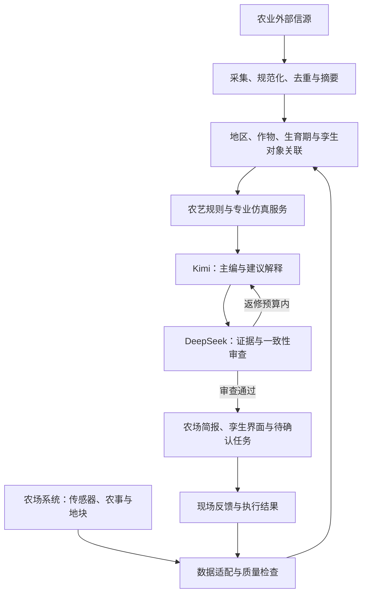

# AgriTwin Intelligence

基于 FeishuBrief 的智慧农业数字孪生情报与决策支持模块。

将外部农业情报与本地地块、作物、传感器观测和农事记录关联，通过专业规则与仿真模型形成有依据的解释、农场简报及待确认任务。

**当前阶段：代码基线复制与方案设计。** 已继承通用采集、摘要、审稿、渲染和通知代码；农业信源、农场数据接入、孪生对象关联、仿真接口和农业界面尚未实现。此仓库目前不能直接生成经过本场验证的农业操作建议。

## 文档入口

- [对话文档归档](docs/conversation-archive/README.md)：2026-10-11 起按分类、日期和版本保存本项目交流生成的方案、调研、验收记录、XMind 等文档；文档所述本地开发状态不代表业务代码已经同步至本仓库。

- [智慧农业数字孪生接入方案 V1](docs/agriculture-digital-twin-integration-v1.md)：业务场景、架构、模型分工、接口草案、部署、实施顺序和验收。
- [代码来源与复制范围](UPSTREAM.md)：FeishuBrief 来源版本、保留内容及本次差异。
- [继承的多模型运行说明](docs/multi-agent-runtime.md)：现有 Kimi 与 DeepSeek 工作流程。
- [FeishuBrief 原始 README](README.upstream.md)：原项目使用说明，包含属于原项目的入口与部署信息。

## 产品方向

| 能力 | 目标用户 | 预期结果 | 当前状态 |
|---|---|---|---|
| 农业技术情报 | 研发人员 | 农业机器人、遥感、作物建模、开源与研究动态 | 通用引擎已复制，农业选题待接入 |
| 农场每日简报 | 农场管理人员 | 地块状态、异常、农事进展和今日关注事项 | 待实现 |
| 情报与孪生关联 | 管理及现场人员 | 从消息定位到地块、温室、作物批次和证据 | 待实现 |
| 事件决策支持 | 农艺与运营人员 | 结合本地数据解释风险、比较方案、形成工单 | 待实现 |
| 效果回看 | 研发与管理人员 | 追踪任务处理、模型误差及建议实际效果 | 待实现 |

第一阶段聚焦“一个农场、一个作物、一个场景”，建议以温室环境异常为演示场景，实际场景待确认。只有三维可视化而没有专业仿真模型时，先提供对象定位、观测解释和待核实事项。

## 目标架构

以下架构为设计目标，不表示组件已经全部实现。



语言模型承担信息提取、相关性判断、文字组织与审查；数值预测由经过验证的专业模型或确定性规则负责。设备实时保护与控制由农业系统已有控制链路承担。

## 已继承的代码基础

- RSS、API、网页等多种来源适配与分源失败隔离。
- 历史排重、新鲜度筛选、论文判断及 GitHub 涨星过滤。
- 通过统一 `runLlm()` 调用模型；Kimi 主编、DeepSeek Worker 摘要与恢复、DeepSeek Pro 审稿。
- 有限返修与复审，空结果和截断检查，审稿失败时阻断通知。
- 静态 HTML 与 JSON 产物，飞书和 PushPlus 通知适配器。
- 编辑配置校验和现有离线回归检查。

当前 `sources.config.json`、`sources.candidates.json` 和 `config/editorial-profile.json` 仍是继承的技术情报配置；原稿件协议仍为科技、财经、时政栏目。农业报告将使用独立协议，不能直接套用原来的 `3/3/2` 最低数量门禁。

## 初始化与验证

本项目继承 Node.js / TypeScript 工具链，依赖版本由 `package-lock.json` 固定。`package.json` 中的包名暂时沿用 `feishu-brief`，以减少初始化时的无关代码变化。

```sh
npm ci
npx tsc --noEmit
npm run sources:check
npm run editorial:check
npm run freshness:check
npm run papers:check
npm run digest:check
npm run roles:check
npm run reviewer:check
npm run readme:check
```

上述是编译与离线数据/配置检查，不执行正式日报或通知。复制后未配置模型或通知密钥。后续确需运行通用原型时，可参考 `.env.example` 配置独立环境；`npm run daily` 会抓取来源并调用模型，尚不是农业专用入口。

`bootstrap.mjs`、安装器和调度脚本也是上游工具，可能注册定时任务或配置用户级工具；农业项目尚未提供一键部署入口。

## 部署与通知边界

- **本仓库没有启用中的 GitHub Actions 工作流。** 原工作流原样保存在 `ops/upstream-workflows/*.yml.disabled`，供后续参考。
- 创建仓库不会运行日报、开通定时任务、部署 Pages 或触发飞书/微信推送。
- 未从 FeishuBrief 复制仓库 Secrets、Variables、Deploy Keys、群 ID 或订阅配置；后续启用时使用本仓库独立配置。
- 原 `FeishuBrief-Console` 属于另一个仓库，本次未复制或改指向。农业前端优先接入现有智慧农业系统。
- 外部资讯批处理可以使用 Actions；及时预警部署在农业后端或边缘服务。
- 农场观测、精确位置、工单和私有诊断保存在农业系统或私有服务，不能发布到原公开日报站点。

## 开发路线

1. 确认农业场景和现有平台接口，建立模拟农场数据及对象标识。
2. 增加农业信源配置和证据适用条件，验证来源可获取性与时效。
3. 实现农场数据适配、单位和时间校验、地块及作物关联。
4. 生成农业专用 JSON 简报，提供对象定位、证据查看和待确认任务。
5. 按具体作物接入专业规则与仿真，再增加方案比较和效果回看。
6. 完成故障恢复、审稿审计、通知幂等与场景验收后，启用独立调度。

详细交付内容和验收条件见[接入方案](docs/agriculture-digital-twin-integration-v1.md)。

## 目录

```text
lib/ai/                  模型调用、摘要、主编与审稿（继承）
lib/sources/             来源适配和去重（继承）
lib/editorial/           编辑配置协议（继承）
lib/output/              通用日报渲染（继承）
lib/trading/             原金融分析模块（保留，农业流程不默认启用）
scripts/                原采集、生成、通知和检查工具
config/                 原编辑配置与能力声明
ops/upstream-workflows/ 未启用的原始工作流
docs/                   接入方案和继承文档
UPSTREAM.md             代码来源与版本说明
README.upstream.md      原项目 README 快照
LICENSE                 原 MIT 许可证与署名
```

## 继承的信源登记表

下表反映复制的配置，**不是农业信源已接入的清单**。“启用”指配置值，不代表本仓库已运行抓取。农业来源的地区、接口、授权与有效期仍需按接入方案逐项确认。

<details>
<summary>查看原技术情报信源配置</summary>

<!-- SOURCE_LIST:START -->

当前登记 **135** 个信源，其中 **108** 个全局启用；中文模式启用 **106** 个。此表由 `npm run readme:sources` 从两份信源配置自动生成。

### 科技 / AI

| 分类 | 信源 | ID | 接入方式 | 状态 | 优先级 |
|---|---|---|---|---|---|
| AI 应用 | [36氪 AI](https://news.google.com/rss/search?q=site%3A36kr.com%20%28AI%20OR%20%E4%BA%BA%E5%B7%A5%E6%99%BA%E8%83%BD%20OR%20%E5%A4%A7%E6%A8%A1%E5%9E%8B%20OR%20%E6%9C%BA%E5%99%A8%E4%BA%BA%29&hl=zh-CN&gl=CN&ceid=CN%3Azh-Hans) | `36kr-ai` | RSS | 启用 | — |
| AI 应用 | [机器之心](https://www.jiqizhixin.com/) | `jiqizhixin-ai` | 网页抓取 | 启用 | — |
| AI 应用 | [a16z AI](https://a16z.com/news-content/) | `a16z-ai` | 网页抓取 | 启用 | — |
| AI 应用 | [CB Insights AI](https://www.cbinsights.com/research/artificial-intelligence/) | `cbinsights-ai` | 网页抓取 | 启用 | — |
| AI 应用 | [Crunchbase AI](https://api.crunchbase.com/api/v4/searches/organizations) | `crunchbase-ai` | API | 启用 | — |
| AI 应用 | [HN AI New](https://hnrss.org/newest?q=AI&points=50) | `hn-ai-new` | RSS | 启用 | — |
| AI 应用 | [HN Launch HN](https://hnrss.org/newest?q=Launch+HN) | `hn-launch-hn-ai` | RSS | 启用 | — |
| AI 应用 | [HN Show AI](https://hnrss.org/show?q=AI+robot+automation) | `hn-show-ai` | RSS | 启用 | — |
| AI 应用 | [Product Hunt](https://www.producthunt.com/feed) | `producthunt-ai` | RSS | 启用 | — |
| AI 应用 | [Sequoia AI](https://sequoiacap.com/stories/) | `sequoia-ai` | 网页抓取 | 启用 | — |
| AI 应用 | [TechCrunch AI](https://techcrunch.com/category/artificial-intelligence/feed/) | `techcrunch-ai` | RSS | 启用 | — |
| AI 应用 | [TechCrunch Funding](https://techcrunch.com/tag/funding/feed/) | `techcrunch-funding-ai` | RSS | 启用 | — |
| AI 应用 | [TechCrunch Startups](https://techcrunch.com/category/startups/feed/) | `techcrunch-startups-ai` | RSS | 启用 | — |
| AI 应用 | [The Spoon](https://thespoon.tech/category/ai/feed/) | `thespoon-ai` | RSS | 启用 | — |
| AI 应用 | [Y Combinator AI](https://api.ycombinator.com/v0.1/companies?batch=S2026&tags=AI) | `ycombinator-ai` | API | 启用 | — |
| AI 新闻 | [量子位](https://www.qbitai.com/feed) | `qbitai` | RSS | 启用 | — |
| AI 新闻 | [DeepMind Blog](https://deepmind.google/blog/rss.xml) | `deepmind-blog` | RSS | 启用 | — |
| AI 新闻 | [Hugging Face Blog](https://huggingface.co/blog/feed.xml) | `huggingface-blog` | RSS | 启用 | — |
| AI 新闻 | [Latent Space](https://www.latent.space/feed) | `latent-space` | RSS | 启用 | — |
| AI 新闻 | [MIT Tech Review AI](https://www.technologyreview.com/topic/artificial-intelligence/feed) | `mit-tech-review-ai` | RSS | 启用 | — |
| AI 新闻 | [OpenAI News](https://openai.com/news/rss.xml) | `openai-news` | RSS | 启用 | — |
| AI 新闻 | [Smol AI News](https://github.com/smol-ai/ainews-web-2025/tree/main/src/content/issues) | `smol-ai-news` | GitHub API | 停用 | — |
| AI 新闻 | [TLDR AI](https://tldr.tech/api/rss/ai) | `tldr-ai` | RSS | 启用 | — |
| 博客周刊 | [阮一峰的网络日志](https://www.ruanyifeng.com/blog/atom.xml) | `ruanyf-blog` | RSS | 停用 | — |
| 博客周刊 | [Cloudflare Blog](https://blog.cloudflare.com/rss/) | `cloudflare-blog` | RSS | 停用 | — |
| 博客周刊 | [GitHub Engineering](https://github.blog/engineering/feed/) | `github-engineering` | RSS | 停用 | — |
| 博客周刊 | [HelloGitHub 月刊](https://hellogithub.com/rss/all) | `hellogithub` | RSS | 停用 | — |
| 博客周刊 | [Martin Fowler](https://martinfowler.com/feed.atom) | `martinfowler` | RSS | 停用 | — |
| 博客周刊 | [Simon Willison](https://simonwillison.net/atom/everything/) | `simonwillison` | RSS | 停用 | — |
| 中文社区 | [掘金](https://juejin.cn/rss) | `juejin` | RSS | 停用 | — |
| 中文社区 | [LinuxDo](https://linux.do/top.rss?period=daily) | `linuxdo` | RSS | 启用 | — |
| 中文社区 | [V2EX](https://www.v2ex.com/api/topics/show.json) | `v2ex-hot` | API | 启用 | — |
| 国内技术媒体 | [极客邦科技](https://www.geekbang.org/) | `geekbang-tech` | 网页列表 | 启用 | T2 |
| 国内技术媒体 | [甲子光年](https://www.jazzyear.com/) | `jazzyear` | 网页列表 | 启用 | T2 |
| 国内技术媒体 | [开源中国](https://www.oschina.net/news) | `oschina-news` | 网页列表 | 启用 | T2 |
| 国内技术媒体 | [雷峰网](https://www.leiphone.com/) | `leiphone-tech` | 网页列表 | 启用 | T2 |
| 国内技术媒体 | [数据派 THU](https://mp.weixin.qq.com/) | `datapie-thu` | 网页列表 | 启用 | T2 |
| 国内技术媒体 | [晚点 LatePost](https://news.google.com/rss/search?q=site%3Alatepost.com%20%28AI%20OR%20%E7%A7%91%E6%8A%80%20OR%20%E4%BA%BA%E5%B7%A5%E6%99%BA%E8%83%BD%20OR%20%E5%A4%A7%E6%A8%A1%E5%9E%8B%29&hl=zh-CN&gl=CN&ceid=CN%3Azh-Hans) | `latepost-tech` | RSS | 启用 | T2 |
| 国内技术媒体 | [芯东西](https://www.zhidx.com/) | `zhidx-chip` | 网页列表 | 启用 | T2 |
| 国内技术媒体 | [新智元](https://news.google.com/rss/search?q=%E6%96%B0%E6%99%BA%E5%85%83%20AI%20%E5%A4%A7%E6%A8%A1%E5%9E%8B&hl=zh-CN&gl=CN&ceid=CN%3Azh-Hans) | `aixinzhiyuan` | RSS | 启用 | T2 |
| 国内技术媒体 | [智东西](https://www.zhidx.com/) | `zhidx-ai` | 网页列表 | 启用 | T2 |
| 国内技术媒体 | [AI 科技评论](https://www.leiphone.com/category/ai) | `leiphone-ai-review` | 网页列表 | 启用 | T2 |
| 国内技术媒体 | [CSDN AI 精选](https://www.csdn.net/) | `csdn-ai` | 网页列表 | 启用 | T2 |
| 国内技术媒体 | [InfoQ 中文](https://www.infoq.cn/) | `infoq-cn` | 网页列表 | 启用 | T2 |
| 国内技术媒体 | [SegmentFault 思否](https://segmentfault.com/) | `segmentfault-tech` | 网页列表 | 启用 | T2 |
| 工程与开源 | [CNCF Blog](https://www.cncf.io/feed/) | `cncf-blog` | RSS | 启用 | T0 |
| 工程与开源 | [Google Project Zero](https://googleprojectzero.blogspot.com/feeds/posts/default) | `project-zero-blog` | RSS | 启用 | T0 |
| 工程与开源 | [OpenSSF Blog](https://openssf.org/feed/) | `openssf-blog` | RSS | 启用 | T0 |
| GitHub Trending | [GitHub Trending](https://github.com/trending) | `github-trending` | 网页抓取 | 启用 | T0 |
| 海外来源 | [BBC Technology](https://feeds.bbci.co.uk/news/technology/rss.xml) | `bbc-tech` | RSS | 停用 | — |
| 海外来源 | [TechCrunch](https://techcrunch.com/feed/) | `techcrunch` | RSS | 停用 | — |
| 海外来源 | [The Verge](https://www.theverge.com/rss/index.xml) | `theverge` | RSS | 停用 | — |
| 海外分析媒体 | [IEEE Spectrum AI](https://spectrum.ieee.org/artificial-intelligence) | `ieee-spectrum-ai` | 网页列表 | 启用 | T2 |
| 海外分析媒体 | [Import AI](https://news.google.com/rss/search?q=site%3Aimportai.substack.com%20AI&hl=en-US&gl=US&ceid=US%3Aen) | `import-ai` | RSS | 启用 | T2 |
| 海外分析媒体 | [Quanta Computer Science](https://www.quantamagazine.org/feed/) | `quanta-computer-science` | RSS | 启用 | T2 |
| 海外分析媒体 | [Stratechery](https://stratechery.com/feed/) | `stratechery` | RSS | 启用 | T2 |
| 海外分析媒体 | [The Batch](https://news.google.com/rss/search?q=DeepLearning.AI%20%22The%20Batch%22&hl=en-US&gl=US&ceid=US%3Aen) | `the-batch` | RSS | 启用 | T2 |
| 海外社区 | [Hacker News](https://hacker-news.firebaseio.com/v0) | `hackernews` | API | 启用 | — |
| 海外社区 | [Lobsters](https://lobste.rs/rss) | `lobsters` | RSS | 停用 | — |
| 海外社区 | [r/stocks](https://www.reddit.com/r/stocks/.rss) | `reddit-stocks` | RSS | 启用 | — |
| 海外新闻 | [Ars Technica](https://feeds.arstechnica.com/arstechnica/index) | `ars-technica` | RSS | 停用 | — |
| 海外新闻 | [Solidot 奇客](https://www.solidot.org/index.rss) | `solidot` | RSS | 停用 | — |
| 政策与标准 | [工信部科技政策](https://www.miit.gov.cn/) | `miit-tech-policy` | 政策网页 | 启用 | T0 |
| 政策与标准 | [国家网信办 AI 政策](https://www.cac.gov.cn/) | `cac-ai-policy` | 政策网页 | 启用 | T0 |
| 政策与标准 | [中国计算机学会](https://www.ccf.org.cn/) | `ccf-news` | 政策网页 | 启用 | T0 |
| 政策与标准 | [中国信通院](https://news.google.com/rss/search?q=site%3Acaict.ac.cn%20(%E4%BA%BA%E5%B7%A5%E6%99%BA%E8%83%BD%20OR%20%E7%AE%97%E5%8A%9B%20OR%20%E6%95%B0%E6%8D%AE%20OR%20%E6%A0%87%E5%87%86)&hl=zh-CN&gl=CN&ceid=CN%3Azh-Hans) | `caict-reports` | RSS | 启用 | T0 |
| 研究机构与公司 | [Anthropic News](https://www.anthropic.com/news) | `anthropic-news` | 网页列表 | 启用 | T0 |
| 研究机构与公司 | [Anthropic Research](https://www.anthropic.com/research) | `anthropic-research` | 网页列表 | 启用 | T0 |
| 研究机构与公司 | [Google Research Blog](https://research.google/blog/) | `google-research-blog` | 网页列表 | 启用 | T0 |
| 研究机构与公司 | [Meta AI Blog](https://news.google.com/rss/search?q=site%3Aai.meta.com%2Fblog%20Meta%20AI&hl=en-US&gl=US&ceid=US%3Aen) | `meta-ai-blog` | RSS | 启用 | T0 |
| 研究机构与公司 | [Microsoft Research Blog](https://www.microsoft.com/en-us/research/feed/) | `microsoft-research-blog` | RSS | 启用 | T0 |
| 研究机构与公司 | [NVIDIA Generative AI Blog](https://developer.nvidia.com/blog/category/generative-ai/feed/) | `nvidia-developer-ai` | RSS | 启用 | T0 |
| 研究机构与公司 | [NVIDIA Research](https://research.nvidia.com/rss.xml) | `nvidia-research` | RSS | 启用 | T0 |
| 研究机构与公司 | [NVIDIA Robotics Blog](https://developer.nvidia.com/blog/category/robotics/feed/) | `nvidia-developer-robotics` | RSS | 启用 | T0 |
| 论文与作者 | [arXiv cs.AI](https://rss.arxiv.org/rss/cs.AI) | `arxiv-cs-ai` | RSS | 启用 | T0 |
| 论文与作者 | [arXiv cs.LG](https://rss.arxiv.org/rss/cs.LG) | `arxiv-cs-lg` | RSS | 启用 | T0 |
| 论文与作者 | [OpenReview](https://openreview.net/) | `openreview` | 网页列表 | 启用 | T0 |
| 技术人物 | [戴琼海论文](https://www.tsinghua.edu.cn/) | `person-dai-qionghai` | OpenAlex | 启用 | T1 |
| 技术人物 | [何恺明论文](https://people.csail.mit.edu/kaiming/) | `person-he-kaiming` | OpenAlex | 启用 | T1 |
| 技术人物 | [李开复 零一万物](https://www.lingyiwanwu.com/) | `person-kai-fu-lee` | 网页列表 | 启用 | T1 |
| 技术人物 | [李沐 GitHub](https://github.com/d2l-ai) | `person-li-mu-github` | GitHub API | 启用 | T1 |
| 技术人物 | [彭志辉 智元技术发布](https://www.agibot.com/) | `person-peng-zhihui` | 网页列表 | 启用 | T1 |
| 技术人物 | [唐杰 智谱技术发布](https://www.zhipuai.cn/) | `person-tang-jie` | 网页列表 | 启用 | T1 |
| 技术人物 | [王小川 百川智能](https://www.baichuan-ai.com/) | `person-wang-xiaochuan` | 网页列表 | 启用 | T1 |
| 技术人物 | [王兴兴 宇树新闻](https://www.unitree.com/cn/news/) | `person-wang-xingxing` | 网页列表 | 启用 | T1 |
| 技术人物 | [杨植麟 月之暗面](https://www.moonshot.cn/) | `person-yang-zhilin` | 网页列表 | 启用 | T1 |
| 技术人物 | [张钹论文](https://www.tsinghua.edu.cn/) | `person-zhang-bo` | OpenAlex | 启用 | T1 |
| 技术人物 | [张亚勤 AIR](https://air.tsinghua.edu.cn/) | `person-zhang-yaqin` | 网页列表 | 启用 | T1 |
| 技术人物 | [周伯文 衔远科技](https://news.google.com/rss/search?q=site%3Afrontis.ai%20%E5%91%A8%E4%BC%AF%E6%96%87%20AI&hl=zh-CN&gl=CN&ceid=CN%3Azh-Hans) | `person-zhou-bowen` | RSS | 启用 | T1 |
| 技术人物 | [朱松纯论文](https://www.bigai.ai/) | `person-zhu-songchun` | OpenAlex | 启用 | T1 |
| 技术人物 | [Ahead of AI](https://magazine.sebastianraschka.com/feed) | `person-sebastian-raschka` | RSS | 启用 | T1 |
| 技术人物 | [Andrej Karpathy GitHub](https://github.com/karpathy) | `person-karpathy-github` | GitHub API | 启用 | T1 |
| 技术人物 | [Andrej Karpathy YouTube](https://www.youtube.com/@AndrejKarpathy) | `person-karpathy-youtube` | YouTube Atom | 启用 | T1 |
| 技术人物 | [Chip Huyen Blog](https://huyenchip.com/blog/) | `person-chip-huyen` | 网页列表 | 启用 | T1 |
| 技术人物 | [Daphne Koller Papers](https://profiles.stanford.edu/daphne-koller) | `person-daphne-koller` | OpenAlex | 启用 | T1 |
| 技术人物 | [Dario Amodei Anthropic Posts](https://www.anthropic.com/news) | `person-dario-amodei` | 网页列表 | 启用 | T1 |
| 技术人物 | [Harrison Chase GitHub](https://github.com/hwchase17) | `person-harrison-chase-github` | GitHub API | 启用 | T1 |
| 技术人物 | [Lilian Weng Blog](https://lilianweng.github.io/) | `person-lilian-weng` | 网页列表 | 启用 | T1 |
| 技术人物 | [Pieter Abbeel Papers](https://people.eecs.berkeley.edu/~pabbeel/) | `person-pieter-abbeel` | OpenAlex | 启用 | T1 |
| 技术人物 | [Schneier on Security](https://www.schneier.com/feed/atom/) | `person-bruce-schneier` | RSS | 启用 | T1 |
| 技术人物 | [Thomas Wolf GitHub](https://github.com/thomwolf) | `person-thomas-wolf-github` | GitHub API | 启用 | T1 |
| 技术人物 | [李沐 B站投稿](https://space.bilibili.com/1567748478) | `person-li-mu-bilibili` | B站 / RSSHub | 启用 | T2 |
| 技术人物 | [稚晖君 B站投稿](https://space.bilibili.com/20259914) | `person-peng-zhihui-bilibili` | B站 / RSSHub | 启用 | T2 |
| 技术人物 | [Demis Hassabis X](https://x.com/demishassabis) | `person-demis-hassabis-x` | X API | 启用 | T3 |
| 技术人物 | [Fei Fei Li X](https://x.com/drfeifei) | `person-feifei-li-x` | X API | 启用 | T3 |
| 技术人物 | [Jeff Dean X](https://x.com/JeffDean) | `person-jeff-dean-x` | X API | 启用 | T3 |
| 技术人物 | [Jim Fan X](https://x.com/DrJimFan) | `person-jim-fan-x` | X API | 启用 | T3 |
| 技术人物 | [Yann LeCun X](https://x.com/ylecun) | `person-yann-lecun-x` | X API | 启用 | T3 |
| 热门论文 | [HuggingFace Trending Papers](https://huggingface.co/api/daily_papers) | `huggingface-papers` | API | 启用 | — |
| X 热点 | [X 推文 (AttentionVC)](https://reply-vc-90459984647.us-central1.run.app/v1/articles/leaderboard?window=3d&category=ai&lang=en&limit=30) | `attentionvc-ai` | API | 启用 | — |

### 财经

| 分类 | 信源 | ID | 接入方式 | 状态 | 优先级 |
|---|---|---|---|---|---|
| 社区 | [r/ChinaStocks](https://www.reddit.com/r/ChinaStocks/.rss) | `reddit-chinastocks` | RSS | 停用 | — |
| 社区 | [r/investing](https://www.reddit.com/r/investing/.rss) | `reddit-investing` | RSS | 停用 | — |
| 社区 | [r/wallstreetbets](https://www.reddit.com/r/wallstreetbets/.rss) | `reddit-wallstreetbets` | RSS | 停用 | — |
| 财经新闻 | [华尔街见闻](https://rsshub.app/wallstreetcn/news/global) | `wallstreetcn` | RSS | 停用 | — |
| 财经新闻 | [人民网财经](http://www.people.com.cn/rss/finance.xml) | `people-finance` | RSS | 停用 | — |
| 财经新闻 | [BBC Business](https://feeds.bbci.co.uk/news/business/rss.xml) | `bbc-business` | RSS | 启用 | — |
| 财经新闻 | [Bloomberg Markets](https://feeds.bloomberg.com/markets/news.rss) | `bloomberg-markets` | RSS | 启用 | — |
| 财经新闻 | [CNBC](https://www.cnbc.com/id/100003114/device/rss/rss.html) | `cnbc-topnews` | RSS | 停用 | — |
| 财经新闻 | [Financial Times](https://www.ft.com/companies?format=rss) | `ft-companies` | RSS | 启用 | — |
| 财经新闻 | [FT中文网](https://www.ftchinese.com/rss/news) | `ftchinese-news` | RSS | 停用 | — |
| 财经新闻 | [MarketWatch](https://feeds.content.dowjones.io/public/rss/mw_topstories) | `marketwatch-top` | RSS | 停用 | — |
| 财经新闻 | [The Economist Finance](https://www.economist.com/finance-and-economics/rss.xml) | `economist-finance` | RSS | 启用 | — |
| 财经新闻 | [WSJ Markets](https://feeds.a.dj.com/rss/RSSMarketsMain.xml) | `wsj-markets` | RSS | 启用 | — |
| 财经新闻 | [Yahoo Finance](https://finance.yahoo.com/news/rssindex) | `yahoo-finance` | RSS | 停用 | — |

### 国际时政

| 分类 | 信源 | ID | 接入方式 | 状态 | 优先级 |
|---|---|---|---|---|---|
| 未分类 | [人民网国际](http://www.people.com.cn/rss/world.xml) | `people-world` | RSS | 停用 | — |
| 未分类 | [人民网时政](http://www.people.com.cn/rss/politics.xml) | `peoples-daily` | RSS | 停用 | — |
| 未分类 | [新华网时政](http://www.xinhuanet.com/politics/news_politics.xml) | `xinhua-politics` | RSS | 停用 | — |
| 未分类 | [RFA 中文](https://www.rfa.org/mandarin/RSS) | `rfa-chinese` | RSS | 停用 | — |
| 国际新闻 | [Al Jazeera](https://www.aljazeera.com/xml/rss/all.xml) | `aljazeera` | RSS | 启用 | — |
| 国际新闻 | [BBC World](https://feeds.bbci.co.uk/news/world/rss.xml) | `bbc-world` | RSS | 启用 | — |
| 国际新闻 | [DW 中文](https://rss.dw.com/rdf/rss-chi-all) | `dw-chinese` | RSS | 启用 | — |
| 国际新闻 | [NPR World](https://feeds.npr.org/1004/rss.xml) | `npr-world` | RSS | 启用 | — |
| 国际新闻 | [NYT World](https://rss.nytimes.com/services/xml/rss/nyt/World.xml) | `nyt-world` | RSS | 启用 | — |
| 国际新闻 | [The Diplomat](https://thediplomat.com/feed/) | `the-diplomat` | RSS | 启用 | — |
| 国际新闻 | [The Guardian](https://www.theguardian.com/world/rss) | `guardian-world` | RSS | 启用 | — |

<!-- SOURCE_LIST:END -->

</details>

## 来源与许可

复制自 [No1dry/FeishuBrief](https://github.com/No1dry/FeishuBrief)，基线提交为 [`ece7f677ff1436f1915d8a14200bd46a1fd5a024`](https://github.com/No1dry/FeishuBrief/commit/ece7f677ff1436f1915d8a14200bd46a1fd5a024)。本仓库采用独立初始化历史，保留来源记录、上游文件和 MIT 许可证；原项目作者署名见 [LICENSE](LICENSE)。
