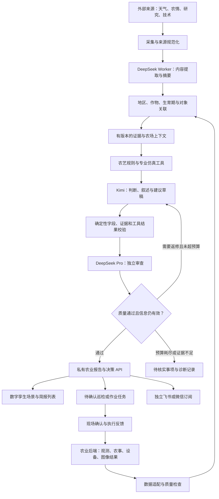

# 智慧农业数字孪生情报与决策支持系统接入方案 V1

日期：2026-09-22

项目：AgriTwin Intelligence

基线：FeishuBrief `ece7f677ff1436f1915d8a14200bd46a1fd5a024`

文档状态：设计方案。当前已复制通用代码基础并建立独立仓库，农业专用模块尚未实现。

## 1. 项目定位

将现有多信源简报智能体接入智慧农业数字孪生平台，提供农业技术情报、农场日常简报和事件决策支持。核心价值是把一条外部信息或本地异常与具体地区、地块、温室、作物批次和生产任务关联起来。

系统应回答：发生了什么、与本场哪些对象有关、依据是什么、哪些信息仍缺失、可以比较哪些方案、谁需要处理，以及执行之后结果如何。

本方案尚未查看实际农业项目源码，也未确认作物、设备协议、专业模型和技术栈。以可接入现有农业后端为设计前提，不绑定 Cesium、Unity、Three.js 或特定业务框架；温室高温仅作为流程示例，不预设为最终生产场景。

## 2. 产品能力与分期

| 能力 | 使用者 | 输入 | 产出 | 分期 |
|---|---|---|---|---|
| 农业技术情报 | 研发人员 | 论文、代码、机构技术资料、设备更新 | 可追溯的研发日报与专题 | P0 |
| 农场每日简报 | 管理人员 | 本地观测、天气、农事记录、相关情报 | 状态概述、异常、今日关注及任务进展 | P1 |
| 情报关联与对象定位 | 管理与现场人员 | 区域、作物、生育期、孪生对象 | 地块或温室高亮、证据详情 | P1 |
| 事件决策支持 | 农艺人员 | 本地异常、专业规则、仿真结果 | 风险解释、方案比较、待确认工单 | P2 |
| 效果回看 | 研发与运营 | 建议版本、执行记录、后续观测 | 预测误差、处置效果、知识修订线索 | P2 |

第一版建议只接入一个农场、一种作物和一个明确场景。先通过历史数据回放证明关联和解释可靠，再接入实时数据；仿真模型可在后续阶段接入。

## 3. 复用 FeishuBrief 的方式

### 3.1 可复用模块

| 现有模块 | 可复用部分 | 农业改造重点 |
|---|---|---|
| `lib/sources/` | 来源适配、错误隔离、抓取结果规范化 | 农业来源、地域适用性、预警生效与失效时间 |
| `lib/sources/freshness.ts` | 历史新鲜度与排重思路 | 预警更新与解除不能被当作普通重复新闻过滤 |
| `lib/ai/` | 角色路由、摘要、主编、审查和故障恢复 | 农业提示词、证据协议、专业工具结果引用 |
| `lib/editorial/` | 配置校验、研究主题和来源偏好 | 农场 Profile、作物、生育期、场景与报告结构 |
| `lib/output/` | 静态渲染与结构化报告基础 | 农业报告模板、孪生对象链接 |
| `scripts/notify-*.mjs` | 飞书与 PushPlus 适配方式 | 独立订阅目标、农业质量门、过期与重复发送控制 |
| 配套检查脚本 | 离线回归与故障注入方法 | 单位、时间、空间、证据与场景测试 |

当前源码仍使用科技、财经、时政三栏目协议。不能把农业内容简单放入科技栏，再沿用 `3/3/2` 的数量门禁。应建立独立农业入口和 `FarmBrief` 协议，并为继承的技术情报流程保留明确边界。

### 3.2 独立仓库与运行配置

新仓库保留来源与许可证，采用独立历史。原活动工作流移入 `ops/upstream-workflows/*.yml.disabled`，没有自动运行。密钥、通知目标、部署仓库和定时任务都需要在农业项目自己的环境中配置。

原技术情报工作台位于独立的 `FeishuBrief-Console` 仓库。本次复制后端不包含该前端，也不会改变原工作台连接。农业系统的界面优先扩展现有项目，通过结构化接口消费情报服务。

## 4. 总体架构



语言模型负责理解、组织和解释，不替代传感器测量或专业数值模型。灌溉量、病害概率、产量或经济收益等数值必须来自已验证规则、模型或数据分析工具，并保留输入条件与模型版本。

若现有平台只有三维展示和实时数据，第一版提供对象定位、异常解释、证据查询和人工任务；没有专业模型时，界面不显示未经验证的情景预测。

## 5. 数据与信源接入

### 5.1 外部来源分类

| 来源类别 | 用途 | 获取策略 | 关键检查 |
|---|---|---|---|
| 气象与农业预警 | 天气影响、灾害风险、农时关注 | 优先正式数据接口，公告为补充 | 发布时间、生效期、地区、预报分辨率、修订与解除 |
| 农艺与病虫害知识 | 解释观测、引用规范、生成巡检线索 | 官方资料、科研机构与本场认可知识 | 作物、品种、地区、试验条件、适用范围 |
| 农业研究与开源 | 研发选题、模型和工程方案追踪 | 论文、代码仓库、机构博客 | 是否有方法证据、代码、数据及适用限制 |
| 设备与工程资料 | 设备维护、能力与接口更新 | 厂商正式文档、版本说明 | 型号、版本、环境、保修与维护要求 |
| 产业与经营信息 | 成本、供应链与政策观察 | 官方发布和可信产业来源 | 地区、发布日期、是否为本场适用政策 |

来源可读取性、授权、接口配额、更新频率和数据许可应逐项登记。网页存在不代表稳定 API 已开放；未核实的来源标为候选，不能在 README 宣称已经接入。

可作为调研起点的中央气象台农业气象产品包含土壤水分、作物发育期和灾害风险信息；实际生产获取方式需要单独核实。[中央气象台农业气象](https://www.nmc.cn/publish/agro/disastersmonitoring/Agricultural_Drought_Monitoring.htm)

### 5.2 本地数据

优先由农业后端提供统一接口，不让情报模块直接连接每个设备。

- 空间对象：农场、地块、温室、区域边界、孪生对象 ID。
- 作物对象：种植批次、作物、品种、生育期、播种与移栽日期。
- 观测：空气与土壤温湿度、土壤水分、光照、雨量等实际可用数据。
- 设备：在线状态、故障、当前模式、可用能力、维护状态。
- 农事：巡检、灌溉、施肥、采收、病虫害观察及任务记录。
- 图像分析：已有视觉模型输出的检测结果、时间、位置和置信信息；原视频流不直接灌入文本模型。

接口优先沿用原系统的 REST、消息总线或 MQTT 网关。跨厂商观测模型可参考 OGC SensorThings 的 Thing、Observation、Datastream、ObservedProperty 和单位设计，但不要求第一阶段迁移全平台。[OGC SensorThings](https://www.ogc.org/standards/sensorthings/)

### 5.3 数据质量与时效

观测必须区分事件时间与入库时间，保留单位、设备标识和质量标记。统一单位后再执行规则，检查时钟偏差、异常跳变、缺测和传感器校准状态。数据新鲜度阈值按观测类型配置，不能把所有传感器都当成同一个更新周期。

外部预警保留发布时间、有效起止时间、发布机构、预警 ID、版本、空间范围和撤销状态。地区级气象预报不是地块现场测量，关联时必须保留尺度差异。

## 6. 孪生对象关联与事件记忆

建立 `tenantId → farmId → plotId/greenhouseId → cropCycleId` 的对象关系，以及业务对象与三维场景对象的映射。跨服务统一对象标识，避免只靠“1 号棚”这样的显示名称匹配。

情报适用性按以下顺序判断：空间范围是否相关；作物及品种是否适用；是否处于相关生育期；信息是否仍有效；本场是否具备必要设备与生产条件；证据是否足够支持当前用途。

输出关联结果时提供命中条件、缺失条件和不确定性。只有区域预警而无本地测量时，可形成“待关注/待核实”，不直接升级为本场已发生灾害。

事件记忆要保留新增、更新、扩大范围、解除和更正。相同预警在多个网站转载时合并；发布机构明确更新严重程度或解除预警时视为实质变化。气象警报采用有效期和事件版本规则，不能直接继承普通资讯的长周期 URL 排重。

## 7. 多模型协作与有限闭环

### 7.1 角色分工

| 角色 | 建议复用 | 职责 | 不承担的职责 |
|---|---|---|---|
| 内容工作角色 | DeepSeek Worker | 农业情报提取、适用条件、摘要、格式恢复 | 自行发明农艺阈值或数值预测 |
| 主编与解释角色 | Kimi | 结合本场上下文组织简报、解释工具结果、形成任务草案 | 绕过权限调用设备 |
| 独立审查角色 | DeepSeek Pro | 检查事实来源、对象归属、单位、时间与建议适用性 | 用自身评分替代农艺验证 |
| 专业计算模块 | 规则或农业模型 | 风险计算、环境预测、方案模拟 | 未经校准就声称适用于所有农场 |
| 编排器 | 确定性程序 | 选择流程、权限校验、重试、审计、发布与通知 | 自行降低门槛以强行通过 |

复用的是角色和统一路由，具体模型 ID 由配置决定。没有充分证据时允许返回“无法判断”或“需要巡检”，不为了补足数量生成建议。

### 7.2 返修流程

证据准备 → Kimi 草稿 → 结构和证据校验 → DeepSeek 审查 → 未通过则根据问题定向返修 → 重新校验和审查 → 通过后发布。

默认最多 4 次内容审查，可参考继承代码；调用重试和模型恢复另计并受总调用数、总 token 与总时长约束。农业预警如果已经过期，流程应停止并重新读取状态，不能把迟到的建议继续当作有效指令。

主编失败可由 Worker 辅助恢复结构；审稿失败可使用受控备用评审，但仍保留证据和适用性硬规则。多模型不是完全独立的事实验证。专业规则不满足、对象无法关联或输入失效时，模型高分也不能放行操作建议。

## 8. 示例：温室高温关注流程

本节为假设场景，不给出任何适用于实际作物的温度阈值或操作剂量。

1. 外部适配器接收到当地高温预报，保存空间范围和有效时间。
2. 关联候选温室、作物批次和生育期，读取最新传感器与设备状态。
3. 质量模块判断数据是否新鲜、单位是否一致、设备是否在线；缺少关键数据时生成核实任务。
4. 专业规则判断是否满足关注条件。若有已校准的温室模型，比较现状与可用通风、遮阳方案。
5. Kimi 解释风险依据、涉及对象、可采取的检查步骤与方案限制。
6. DeepSeek 检查是否把室外温度当成室内温度、是否把预报当实测、是否引用了不适用的作物条件。
7. 农业界面定位温室，展示观测曲线、证据和待确认任务。
8. 现场人员确认并处理，系统回填执行时间及后续观测，形成效果记录。

设备保护逻辑和实时控制继续在现有控制系统中执行。模型不可用时，已验证的本地阈值告警仍应工作；情报模块故障不能阻断原有监控。

## 9. 农业报告与前端设计

### 9.1 独立报告结构

`FarmBrief` 建议包含农场与时间窗口、数据覆盖说明、状态总览、待关注事件、待核实事项、农事任务进展、农业技术情报和来源索引。

每个风险或关注项包含关联对象、依据、当前状态、严重程度来源、有效期、建议下一步和证据链接。严重程度来自经确认规则或正式预警，不由语言模型根据语气任意确定。

允许某天没有风险事项、没有新技术情报。栏目数量由实际事件决定，不沿用技术日报的固定最低新闻条数。

### 9.2 界面组件

| 组件 | 功能 |
|---|---|
| 农场晨报 | 总览、数据覆盖、今日关注、任务变化 |
| 孪生对象定位 | 点击条目定位地块或温室，关联业务 ID |
| 证据侧栏 | 来源、观测时间、单位、适用性、缺失信息 |
| 事件时间线 | 预警更新、解除、现场确认与历史处置 |
| 情景对比 | 展示专业模型输出、假设、版本和不确定性 |
| 待确认任务 | 分派、确认、状态跟踪及重复工单合并 |
| 运行质量视图 | 来源失败、数据过期、模型轮次与被阻断原因 |

现有农业前端通过 API 读取结构化数据，展示农业服务自己的对象详情。不建议把原通用日报页面直接嵌入 iframe 作为完整集成。

## 10. 数据协议草案

以下协议是待实现的领域模型，不表示目前已有这些 API 或数据库表。

| 对象 | 核心字段 |
|---|---|
| FarmContext | tenantId、farmId、位置/边界、timezone、设备能力 |
| CropCycle | cropCycleId、plotId、作物、品种、生育期、关键日期 |
| Observation | observationId、sensorId、对象 ID、指标、value、unit、observedAt、ingestedAt、quality |
| Evidence | evidenceId、来源类型、来源引用、时间、有效期、适用地区与作物、证据版本 |
| AgricultureEvent | eventId、关联对象、状态、证据集合、更新与解除关系 |
| SimulationResult | simulationId、模型版本、输入快照、假设、结果、适用范围、校准信息 |
| Advice | adviceId、对象、结论、证据 ID、仿真 ID、数据缺口、有效期、审核状态 |
| FarmBrief | reportId、版本、farmId、窗口、栏目、输入快照与质量记录 |
| TaskDraft | taskId、adviceId、对象、建议检查动作、负责人、状态、幂等键 |

示例为模拟数据，不能直接用作真实建议：

```json
{
  "schemaVersion": 1,
  "adviceId": "demo-advice-001",
  "tenantId": "demo-tenant",
  "farmId": "demo-farm",
  "twinObjectId": "demo-greenhouse-01",
  "cropCycleId": "demo-cycle-01",
  "status": "needs_verification",
  "title": "核实预报时段内的温室环境与设备状态",
  "evidenceIds": ["demo-weather-001"],
  "simulationId": null,
  "missingData": ["最新室内温湿度", "通风设备可用状态"],
  "validUntil": "2026-09-23T08:00:00+08:00",
  "nextAction": "获取最新观测并安排现场检查",
  "requiresConfirmation": true
}
```

来源 URL、观测 ID 和工具结果 ID 必须由程序校验。外部文章中的指令只是待处理内容，不能改变模型任务、访问权限或工具参数白名单。

## 11. 集成接口草案

农业系统提供数据接口或网关，情报模块通过适配器接入。路径下的 farmId 等参数必须经过服务端授权，不能仅依靠客户端提交 tenantId 实现隔离。

| 方向 | 接口示意 | 作用 |
|---|---|---|
| 农业系统 → 情报模块 | `GET /farms/{farmId}/context` | 地块、作物、设备及业务对象快照 |
| 农业系统 → 情报模块 | `GET /farms/{farmId}/observations?from=...&to=...` | 指定窗口观测与质量标记 |
| 农业系统 → 情报模块 | 订阅 `observation.updated`、`task.completed` | 事件驱动更新 |
| 情报模块 → 农业系统 | `GET /intelligence/farms/{farmId}/briefs` | 查询合格报告与版本 |
| 情报模块 → 农业系统 | `GET /intelligence/events/{eventId}` | 查看事件、证据和适用条件 |
| 情报模块 → 仿真服务 | `POST /simulations` | 提交经过校验的方案与输入快照 |
| 情报模块 → 任务服务 | `POST /task-drafts` | 生成待确认任务，不直接驱动设备 |
| 农业系统 → 情报模块 | `POST /intelligence/feedback` | 回填核实、误报、采纳和执行效果 |

支持增量游标、分页、请求超时和可重试状态。事件按 observationId/eventId/版本去重；处理乱序和重复消息。仿真调用采用异步任务 ID，避免长请求阻塞农业系统。

设备写操作不在首版 API 中。后续如果需要自动执行，必须独立设计设备能力约束、审批和撤销机制，并验证执行前的最新状态。

## 12. 部署、存储与运行隔离

### 12.1 两种运行节奏

| 流程 | 建议位置 | 触发方式 |
|---|---|---|
| 农业技术资讯与论文 | GitHub Actions 或农业服务器批处理 | 每日/每周 |
| 农场晨报 | 可访问农场数据的私有后端 | 固定时段，按农场时区 |
| 及时预警解释 | 农业服务器或边缘服务 | 预警/异常事件触发 |
| 设备保护与实时控制 | 原农业控制器或既有控制服务 | 独立于模型链路 |

现有 FeishuBrief 的 Actions 曾出现小时级启动延迟，不能作为本地及时告警的唯一触发器。公网 Actions 若访问不到农场内网，不为方便集成而直接暴露传感器网络；可采用农业服务器消费外部情报产物的方式。

### 12.2 存储分工

沿用农业系统已有的时序、空间和业务存储，不额外复制全部高频观测。情报模块保存输入快照引用、内容证据、事件关联、模型审查、报告版本和反馈。大附件按需要存入私有对象存储，设置可追溯保留策略。

公开研究情报与内部农场报告采用分开的产物路径和访问权限。云模型只接收任务必需的聚合数据与证据；精确位置、农场身份、图像等按项目的数据处理规则最小化传入。

每次运行绑定代码版本、配置版本、数据时间窗口和专业模型版本。发布前重新检查预警有效期。通知采用报告版本/事件版本、渠道和订阅对象组成的幂等键；单渠道失败只重试该渠道。

## 13. 代码改造计划

以下是拟新增结构，尚未建立或执行：

```text
lib/agriculture/types.ts          农场、证据、事件和报告协议
lib/agriculture/context.ts        地块、作物、生育期上下文
lib/agriculture/applicability.ts  空间、时间与作物适用性判断
lib/agriculture/quality.ts        观测质量与证据硬校验
lib/agriculture/pipeline.ts       农业生成、审稿及返修编排
lib/agriculture/adapters/         农业后端、气象及专业模型适配
lib/agriculture/events.ts         事件版本、更新、解除和历史关联
lib/output/render-agriculture.ts 农业 HTML 展示（按需）
scripts/agriculture-daily.ts      独立农业入口
config/agriculture-profile.json  独立农业配置
```

模型调用继续统一经过 `lib/ai/llm.ts`。来源扩展保持配置驱动；如果需要独立农业注册表，应明确加载与校验路径，不在代码里硬编码来源清单。新配置不能被原 Console 误写到原技术简报配置。

农业服务接口优先挂接现有后端；是否单独部署服务，待获得实际技术栈后决定。原 `lib/trading/` 保留为继承代码，农业入口不默认调用金融分析模块。

## 14. 实施阶段与验收

| 阶段 | 交付内容 | 验收条件 |
|---|---|---|
| 0：基线与方案 | 独立私库、README、源码快照、停用工作流、本文 | 文件可追溯、检查脚本可运行、无生产任务触发 |
| 1：场景与离线适配 | 一农场一作物一场景、数据字典、模拟接口、农业来源候选 | 能定位业务对象、说明数据来源和缺失项 |
| 2：农业晨报 | 农业专用协议、上下文关联、有限审稿、私有报告 | 无虚构观测；错误地区/作物不能产生操作建议 |
| 3：前端联动与任务 | 孪生定位、证据侧栏、事件时间线、待确认任务 | 点击条目能定位正确对象，重复事件不重复建单 |
| 4：专业模型 | 校准后的规则/仿真接口、方案比较 | 数值能复算、输入与版本可追溯、超范围不外推 |
| 5：生产调度 | 独立调度、通知、恢复与审计 | 过期不推送、单渠道重试幂等、模型故障不影响本地监控 |

阶段 0 是本次仓库初始化范围；之后的阶段需要实际农业项目的场景和接口信息。

### 必测故障与误判

- 传感器离线、延迟上报、单位错误、时钟偏差和重复观测。
- 预警空间范围不重叠、作物不适用、信息已过期或被解除。
- 外部预报与现场观测冲突，以及一处测量被错误推广到全农场。
- 仿真模型缺参数、未校准、超出适用范围或计算失败。
- Kimi/DeepSeek 超时、空响应、截断、返修无进展或总预算耗尽。
- 多次重跑、重复消息、错误地块跳转和单渠道通知失败。

质量评估需人工核对证据与农业适用性，不能仅看模型分数。专业模型精度用历史实测及现场验证评估；建议效果还需考虑作物阶段、天气、执行差异等干扰因素，不能凭执行前后一次对比宣称因果收益。

## 15. 后续需要确认的信息

| 信息 | 用途 | 不具备时的起步方式 |
|---|---|---|
| 露地、温室、果园等场景与主要作物 | 定义关联条件和首版用例 | 先用标明为模拟的数据 |
| 前端与后端技术栈、仓库或接口说明 | 决定页面和 API 的集成位置 | 先定义无框架依赖的 JSON 协议 |
| 传感器类型、单位、更新周期和接入协议 | 检查观测质量与时效 | 先进行离线历史回放 |
| 地块、温室、批次和三维对象 ID | 对象定位 | 先建立映射表 |
| 现有仿真模型与校准情况 | 决定是否可以比较方案 | 先提供观测解释和待核实任务 |
| 部署网络、用户角色与权限体系 | 决定事件服务与数据访问位置 | 先只接入只读数据 |
| 农艺人员认可的规则与参考资料 | 定义可用证据与建议范围 | 只提供情报线索，不输出未验证操作量 |

## 16. 参考与来源

- [FeishuBrief 基线提交](https://github.com/No1dry/FeishuBrief/commit/ece7f677ff1436f1915d8a14200bd46a1fd5a024)：代码来源，复制范围见 [UPSTREAM.md](../UPSTREAM.md)。
- [现有多模型运行说明](multi-agent-runtime.md)：继承能力及其当前边界。
- [OGC SensorThings API](https://www.ogc.org/standards/sensorthings/)：异构传感器观测与元数据的标准化参考。
- [中央气象台农业气象产品](https://www.nmc.cn/publish/agro/disastersmonitoring/Agricultural_Drought_Monitoring.htm)：农业气象来源调研起点，需另核实获取方式。
- [FAO 植物健康预警介绍](https://www.fao.org/one-health/highlights/early-warning-systems-for-plant-health/en)：结合现场监测与预报形成预警的业务参考，不代表已接入该平台。

以上参考用于业务与接口设计，不代表已经完成授权、接入或本地适用性验证。
