# FeishuBrief 多智能体信源到日报与周报一体化执行方案 V2

## 1. 文档信息

| 项目 | 内容 |
|---|---|
| 文档版本 | V2.0 |
| 文档状态 | 待实施 |
| 适用仓库 | `No1dry/FeishuBrief` |
| 运行环境 | GitHub Actions |
| 输出形态 | 周一至周六日报；周日内部日报加对外周报 |
| 模型角色 | DeepSeek Flash 工作智能体、Kimi K2.6 主编、DeepSeek Pro 审稿与接管 |
| 输出渠道 | GitHub Pages、飞书、PushPlus |
| 核心原则 | 先保证质量和可追溯，再保证覆盖；宁缺毋滥；同一信息不跨日机械重复 |

本文件是《多智能体信源到日报一体化执行方案》的 V2，保留 V1，不覆盖原文件。V2 新增或强化：

1. VLA、Agent、World Model、具身智能论文专项策展。
2. 论文质量评分、跨平台去重和 14 天历史排重。
3. 周一至周六日报、周日只推送周报的双周期产品。
4. 周报事件演进聚类、跨日去重和下周观察清单。
5. 三个模型角色的边界、接管关系和调用预算。
6. GitHub Actions 多次错峰探测、幂等运行和通知安全。
7. 日报与周报各自独立的质量门和发布决策。

## 2. 当前基础与问题

### 2.1 当前已经具备

- 135 个登记信源，中文模式约 107 个启用信源。
- RSS、API、Web、GitHub、X、B站、YouTube、论文作者等适配器。
- GitHub Actions 内置临时 RSSHub，支持 B站登录态。
- 每日抓取、中文介绍、最终总览、HTML、GitHub Pages、飞书和 PushPlus。
- Kimi 请求超时控制、紧凑恢复请求和正常本地降级稿。
- 正常总览维持 60 条候选：技术 25、财经 20、时政 15。
- 论文已加入 VLA、Agent、World Model、具身智能关键词与确定性质量评分。
- 论文跨 Hugging Face/arXiv ID 去重，读取最近 14 期历史，最多展示 20 篇且允许不足。

### 2.2 当前仍需解决

1. 大量逐项中文摘要与最终成稿集中在 Kimi，吞吐和超时风险仍集中。
2. 同一事件被多家媒体重复报道，尚未稳定形成事件级记录。
3. 当前论文评分以确定性信号为主，缺少模型语义评审和外部学术信号。
4. 每天报告相互独立，尚不能识别“一周内持续发展”的主题。
5. GitHub 单次 cron 可能延迟或不投递，单一触发点无法自我补跑。
6. 日报与通知耦合，缺少正式的“只生成”“只推送已有报告”运行模式。

## 3. 建设目标

### 3.1 产品目标

| 周期 | 内部执行 | 用户收到 |
|---|---|---|
| 周一至周六 | 抓取、筛选、分析、生成并发布日报 | 当日日报 |
| 周日 | 照常生成当日日报并保存，但跳过日报通知 | 不收到日报 |
| 周日日报完成后 | 读取周一至周日七份日报和内部产物，生成周报 | 只收到周报 |

### 3.2 质量目标

| 指标 | 日报目标 | 周报目标 |
|---|---:|---:|
| 中文介绍覆盖率 | 100% | 100% |
| 来源可追溯率 | 100% | 100% |
| 明显重复事件占比 | 小于 5% | 小于 3% |
| 无证据数字或实体 | 0 | 0 |
| 论文数量 | 最多 20，必须过阈值 | 5 到 8 篇，必须过二次评审 |
| 历史重复论文 | 最近 14 期内 0 | 同周 0，跨周无变化不重复 |
| 日报候选覆盖 | 60 条 | 读取完整 7 天日报产物 |
| Reviewer 通过分 | 80 分 | 85 分 |
| 模型单点故障导致低质推送 | 0 | 0 |

### 3.3 非目标

- 不构建多个 Agent 自由聊天、无限反思或自主循环的系统。
- 不允许模型自主修改代码、信源、Secret 或推送目标。
- 不把七天全部原始抓取结果直接塞给周报模型。
- 不把出现次数等同于重要性。
- 不为了固定数量加入低质量论文、弱相关事件或旧内容。
- 不在用户可见页面中显示模型失败、重试、超时或降级状态。

## 4. 总体架构图


架构图采用三个模型角色、一个确定性编排器。模型只处理被授权的数据转换任务，任务顺序、重试、状态、阈值和发布权都由非模型模块控制。

### 4.1 可编辑架构图

```mermaid
flowchart LR
  S[多平台信源<br/>RSS API Web GitHub X B站<br/>arXiv OpenReview] --> F[抓取调度器]
  F --> N[规范化与安全清洗]
  N --> D[URL 标题 arXiv ID 去重]
  D --> H[14 天历史排重]
  H --> C{摘要缓存命中?}

  C -- 未命中 --> W[DeepSeek Flash<br/>工作智能体]
  C -- 命中 --> E[事件聚类器]
  W --> E
  W --> P[论文语义初审]
  P --> E

  E --> T[主题简报构建器]
  T --> K[Kimi K2.6<br/>主编智能体]
  K --> R[DeepSeek Pro<br/>审稿智能体]
  R --> Q{确定性质量门}
  Q -- 日报通过 --> SUN{周日?}
  SUN -- 周一至周六 --> O[HTML JSON 渲染]
  O --> G[GitHub Pages]
  G --> M[飞书与 PushPlus]

  K -. 超时或失败 .-> R
  K -. 与 Pro 均失败 .-> L[正常本地编辑稿]
  L --> Q

  A[(digest-state<br/>缓存 检查点 运行清单)] <--> C
  A <--> E
  A <--> T

  SUN -- 是 --> WD[保存周日日报<br/>跳过日报通知]
  WD --> WS[读取最近 7 天日报]
  WS --> WE[跨日事件演进聚类]
  WE --> WK[Kimi 周报主编]
  WK --> WR[DeepSeek Pro 周报审校]
  WR --> WQ{周报质量门}
  WQ -- 通过 --> O
```



## 5. 模型数量与角色

系统使用三个模型角色，对应两个模型服务商。一个模型可以运行多个逻辑 Agent，但角色配置、Prompt、输入输出和超时必须隔离。

### 5.1 角色总表

| 模型角色 | 建议模型 | 推理模式 | 主要输入 | 主要输出 | 是否拥有发布权 |
|---|---|---|---|---|---|
| 工作智能体 | `deepseek-v4-flash` | 默认非思考或 low | 规范化条目批次 | TopicItem、PaperAssessment | 否 |
| 主编智能体 | `kimi-k2.6` | 标准 | 结构化主题简报 | DailyReport、WeeklyReport | 否 |
| 审稿智能体 | `deepseek-v4-pro` | low/high | 成稿加证据索引 | ReviewResult、修订意见 | 否 |
| 确定性发布器 | 非大模型 | 不适用 | 成稿、审稿结果、Schema | 发布或阻断决定 | 是 |

DeepSeek 官方当前提供 `deepseek-v4-flash` 与 `deepseek-v4-pro`，支持 JSON Output、OpenAI/Anthropic 兼容接口。正式接入前仍应以官方模型与价格页为准。

### 5.2 DeepSeek Flash 工作智能体

DeepSeek Flash 承担数量大、结构固定、可以并行的任务。

| 逻辑 Agent | 负责内容 | 输出重点 |
|---|---|---|
| Research Worker | 论文、研究机构博客 | 问题、方法、实验、结果、研究价值 |
| Engineering Worker | GitHub、Release、工程博客 | 功能、技术栈、工程价值、适用场景 |
| Industry Worker | 产品、公司、融资、应用 | 产品变化、商业影响、落地证据 |
| People Worker | X、博客、B站、演讲 | 人物观点、事实发布、判断与上下文 |
| Finance Worker | 财经新闻、行情指标 | 宏观、指数、资产、关键数字 |
| Policy Worker | 政府、政策、国际新闻 | 政策、外交、监管、潜在影响 |
| Paper Judge | VLA、Agent、World Model、具身智能论文 | 方向匹配、质量评分、证据、推荐理由 |
| Weekly Extractor | 七天 TopicItem 和日报 | 跨日事件、首次出现、后续进展、趋势强度 |

Flash 不负责最终标题和全局叙事，也不可以决定发送通知。

### 5.3 Kimi K2.6 主编智能体

Kimi 运行两套互相隔离的主编 Prompt。

**日报主编职责：**

- 从 60 条来源均衡的候选中提炼当日主线。
- 生成头条、总览、科技、财经、时政简报。
- 结合 Topic Brief，而不是重新理解全部原始网页。
- 输出正常中文编辑短评和关键词。

**周报主编职责：**

- 从跨日事件链中提炼 3 到 5 条本周核心趋势。
- 区分本周新事件、持续演进事件和没有实质变化的重复报道。
- 重点组织 VLA、Agent、World Model 和具身智能研究进展。
- 形成“本周发生什么、为什么重要、如何发展、下周看什么”的叙事。
- 不按周一到周日机械复述七篇日报。

### 5.4 DeepSeek Pro 审稿与接管智能体

DeepSeek Pro 有两个职责，但在一次运行中必须明确当前身份。

**审稿身份：**

- 检查结论是否能映射到证据条目。
- 检查数字、人名、机构、时间和因果关系。
- 检查同一事件是否重复出现。
- 检查标题是否夸大，摘要是否超出原文。
- 检查周报是否真正体现“变化”，而非出现次数。
- 输出结构化修订意见，最多允许主编修订一次。

**接管身份：**

- Kimi 超时、拒绝或输出无法修复时，使用同一输入独立成稿。
- 接管稿仍需经过确定性质量门。
- 不允许 Reviewer 自己审自己；接管时由确定性门禁加严格阈值负责最终判断。

## 6. 非大模型模块

### 6.1 GitHub Actions 编排器

- 决定日报、周报、只生成和只通知模式。
- 读取时区和日期，保证周日分支正确。
- 负责并发上限、超时、重试、检查点和幂等键。
- 任何模型都不能改变工作流分支。

### 6.2 信源适配层

- RSS/Atom、REST API、HTML 列表、GitHub、X、RSSHub、OpenAlex 等统一为 `NormalizedArticle`。
- 单个信源失败只记录，不阻断其他信源。
- 所有网页内容均视为不可信输入，去除脚本、HTML 和潜在提示注入文本。

### 6.3 规范化与去重层

- URL canonicalization：去跟踪参数、统一跳转、统一尾斜杠。
- arXiv/Hugging Face 按 arXiv ID 跨平台去重。
- DOI、GitHub Repository/Release 使用稳定主键。
- 标题近似度用于多媒体同事件候选聚类。
- 已展示论文读取最近 14 期历史，禁止再次进入日报论文模块。

### 6.4 事件聚类器

- 确切 URL 和规范标题先确定性聚类。
- 标题 Jaccard、实体、时间窗口形成候选簇。
- 只有边界样本交给 DeepSeek Flash 判断。
- 每个事件保存主来源、补充来源、首次时间和最新变化。

### 6.5 缓存与检查点

- 摘要缓存避免同一内容重复调用模型。
- 阶段检查点支持从失败位置恢复，不重新抓取全部来源。
- Prompt 版本、模型角色或正文哈希变化时自动失效。
- 缓存位于私有 `digest-state` 分支，不发布到公开站点。

### 6.6 确定性质量门

- JSON Schema 与字段完整性。
- URL 必须来自输入白名单。
- 数字和实体必须存在于证据索引。
- 日报/周报条数、语言、重复率、覆盖率和审稿分数达标。
- 发布和通知是质量门之后的独立动作。

### 6.7 渲染与通知

- 同一份结构化报告生成 HTML 和 JSON。
- GitHub Pages 成功发布后才允许通知。
- 飞书和 PushPlus 分别记录结果，任何日志不输出 Secret 或完整群 ID。
- 支持指定日期“只推送已有报告”，不重新调用模型。

## 7. 日报执行 DAG

```text
错峰定时探测
-> 幂等检查：今天是否已有成功报告
-> 恢复历史日报与 digest-state
-> 启动 RSSHub
-> 并发抓取全部启用信源
-> 规范化、安全清洗、精确去重
-> 论文方向过滤、质量初筛、14 天历史排重
-> 摘要缓存查询
-> DeepSeek Flash 分领域批量处理未命中项
-> 事件聚类和 Topic Brief
-> 形成 60 条来源均衡候选
-> Kimi 日报主编成稿
-> DeepSeek Pro 独立审稿
-> 最多一次定向修订
-> 确定性质量门
-> 写入日报与运行清单
-> 渲染并发布 GitHub Pages
-> 周一至周六：飞书和 PushPlus 通知
-> 周日：跳过日报通知，进入周报 DAG
```

### 7.1 日报候选配额

| 领域 | 正常候选 | 恢复请求候选 |
|---|---:|---:|
| 技术 | 25 | 16 |
| 财经 | 20 | 11 |
| 时政 | 15 | 9 |
| 合计 | 60 | 36 |

36 条仅用于正常请求已经失败后的紧凑恢复请求。正常路径和本地编辑稿继续使用完整 60 条。

## 8. 周报执行 DAG

### 8.1 数据窗口

- 周报窗口固定为本地时区周一 00:00 至周日当日日报完成。
- 输入为七份 `<date>.json`、七份已展示条目索引和事件聚类产物。
- 不重新请求 RSS、网页、X、B站或论文平台。
- 不把七天 6000 条左右的原始抓取内容直接送入模型。

### 8.2 周报流水线

```text
验证七天日报完整性
-> 读取 DailyReport、TopicItem、EventCluster、论文选择记录
-> 规范化跨日事件 ID
-> 合并同一事件的连续进展
-> 标记：首次出现 / 有实质进展 / 无变化重复
-> DeepSeek Flash 分领域生成 WeeklyTopicBrief
-> 选择本周 3-5 条主线和 5-8 篇重点论文
-> Kimi 周报主编成稿
-> DeepSeek Pro 按证据逐项审校
-> 最多一次修订
-> 周报质量门
-> 发布 `/weekly/<ISO-WEEK>/`
-> 只推送周报到飞书和 PushPlus
```

### 8.3 周报内容结构

1. 本周一句话判断。
2. 本周总览：技术、市场和政策主线。
3. 3 到 5 条核心趋势，每条包含变化链和影响。
4. VLA、Agent、World Model、具身智能专题观察。
5. 本周 5 到 8 篇重点论文及“为什么值得看”。
6. 工程、开源、模型和产品的重要发布。
7. 影响技术产业的财经与政策信号。
8. 下周观察清单。

### 8.4 周报不是七篇日报拼接

以下输出视为失败：

- 按日期罗列“周一发生、周二发生”。
- 同一事件用不同媒体标题重复多次。
- 只统计出现次数，不说明实质变化。
- 只有摘要，没有判断依据和影响。
- 把没有更新的上周主题再次包装成新趋势。

## 9. 论文专项智能体

### 9.1 研究重点

一级重点：

- VLA / Vision-Language-Action。
- Agent / Agentic System，优先 LLM Agent、工具调用、软件工程 Agent、自主研究。
- World Model，包括视频世界模型、潜在动力学和可交互环境模型。
- 具身智能、Robot Learning、Robot Policy、Visuomotor Learning。

### 9.2 候选来源

- arXiv `cs.AI`、`cs.LG`，先按标题和摘要关键词过滤。
- Hugging Face Daily Papers，保留点赞和趋势信号。
- OpenReview，仅接收正式论文、接收状态、oral/spotlight/poster，不抓首页公告。
- 重点作者 OpenAlex 论文。
- 后续可补充 Semantic Scholar、Papers with Code、GitHub 代码链接。

### 9.3 两阶段评分

**阶段 A：确定性评分。**

| 信号 | 用途 |
|---|---|
| 方向关键词与同义词 | 硬相关性 |
| 摘要长度和方法描述 | 信息完整度 |
| benchmark、实验、消融、真实环境 | 证据强度 |
| code、dataset、open-source | 可复现性 |
| Hugging Face upvotes | 社区关注度 |
| 时间、作者、机构 | 新鲜度与来源背景 |
| 偏离领域词和公告页 | 惩罚项 |

低于确定性阈值的候选不调用模型。

**阶段 B：DeepSeek Paper Judge。**

```ts
interface PaperAssessment {
  paperKey: string;
  focusTags: Array<"VLA" | "Agent" | "World Model" | "Embodied AI">;
  relevance: number;
  novelty: number;
  evidenceStrength: number;
  reproducibility: number;
  potentialImpact: number;
  confidence: number;
  recommendation: "must-read" | "recommended" | "skip";
  reasonZh: string;
  evidence: string[];
}
```

### 9.4 论文展示规则

- 每日最多 20 篇，不设“必须凑满”的下限。
- arXiv 合计最多 6 到 8 篇，防止单平台占满。
- 同一 arXiv ID 只保留质量信息更完整的一条。
- 最近 14 期已经展示过的论文不再出现。
- 每周从当周日报已入选论文中二次选择 5 到 8 篇。
- 没有符合条件的 VLA 论文时，VLA 分组允许为空，不用泛机器人论文冒充。

## 10. 数据协议

### 10.1 NormalizedArticle

```ts
interface NormalizedArticle {
  id: string;
  canonicalUrl: string;
  sourceId: string;
  sourceName: string;
  category: "tech" | "finance" | "politics";
  subcategory?: string;
  title: string;
  excerpt: string;
  publishedAt?: string;
  fetchedAt: string;
  sourceTier: "T0" | "T1" | "T2" | "T3";
  contentHash: string;
}
```

### 10.2 TopicItem

```ts
interface TopicItem {
  articleId: string;
  canonicalUrl: string;
  sourceId: string;
  topic: string;
  event: string;
  summaryZh: string;
  entities: string[];
  numbers: string[];
  technologies: string[];
  importance: number;
  novelty: number;
  confidence: number;
  evidence: Array<{ claim: string; sourceUrl: string }>;
}
```

### 10.3 EventCluster

```ts
interface EventCluster {
  clusterId: string;
  category: "tech" | "finance" | "politics";
  topic: string;
  primaryArticleId: string;
  articleIds: string[];
  sourceCount: number;
  firstSeenAt: string;
  lastChangedAt: string;
  changeType: "new" | "updated" | "unchanged";
  mergedSummaryZh: string;
  importance: number;
  confidence: number;
}
```

### 10.4 WeeklyEvent

```ts
interface WeeklyEvent {
  weeklyEventId: string;
  clusterIds: string[];
  title: string;
  firstSeenDate: string;
  lastChangedDate: string;
  evolution: Array<{
    date: string;
    change: string;
    evidenceUrls: string[];
  }>;
  trendStrength: number;
  weeklyImportance: number;
  whyItMattersZh: string;
}
```

### 10.5 WeeklyReport

```ts
interface WeeklyReport {
  isoWeek: string;
  weekStart: string;
  weekEnd: string;
  heroHeadline: string;
  weeklyOverview: string;
  coreTrends: WeeklyEvent[];
  researchFocus: Array<{
    topic: string;
    summaryZh: string;
    evidenceUrls: string[];
  }>;
  keyPapers: Array<{
    title: string;
    url: string;
    whyItMattersZh: string;
  }>;
  engineeringAndIndustry: TopicItem[];
  financeAndPolicy: TopicItem[];
  nextWeekWatchlist: string[];
  keywords: string[];
}
```

### 10.6 ReviewResult 与发布决定

```ts
interface ReviewResult {
  pass: boolean;
  score: number;
  unsupportedClaims: string[];
  duplicateEvents: string[];
  missingCoverage: string[];
  languageIssues: string[];
  revisionInstructions: string[];
}

interface PublicationDecision {
  publishPage: boolean;
  sendNotifications: boolean;
  reasonCodes: string[];
}
```

## 11. 调用与接管策略

### 11.1 Worker 批次

| 参数 | 建议值 |
|---|---:|
| 每批条目 | 12 到 16 |
| 并发批次 | 3 |
| 单批超时 | 120 秒 |
| SDK 自动重试 | 0 |
| 编排层重试 | 1 |
| 输出 | JSON Schema |
| 思考模式 | 默认关闭，论文边界判断用 low |

### 11.2 日报主编

| 参数 | 正常请求 | 恢复请求 |
|---|---:|---:|
| 候选条目 | 60 | 36 |
| 超时 | 300 秒 | 240 秒 |
| 最大输出 | 8192 tokens | 6144 tokens |
| SDK 自动重试 | 0 | 0 |
| 编排层次数 | 1 | 1 |

### 11.3 周报主编

| 参数 | 建议值 |
|---|---:|
| 输入 | 7 天 Topic Brief、事件链、论文精选 |
| 最大核心事件 | 30 |
| 超时 | 360 秒 |
| 最大输出 | 10000 tokens |
| 恢复输入 | 20 个最高分事件 |
| 最大修订轮数 | 1 |

### 11.4 故障矩阵

| 故障 | 日报处理 | 周报处理 |
|---|---|---|
| Flash 单批失败 | 重试一次，之后缓存或本地摘要 | 跳过失败批并检查覆盖 |
| Kimi 超时 | DeepSeek Pro 接管 | DeepSeek Pro 接管 |
| Reviewer 超时 | 确定性门后可继续日报 | 不自动发送周报，保留待审核页面 |
| 两个模型均失败 | 正常本地日报 | 生成内部草稿，不发送周报通知 |
| Pages 发布失败 | 不通知 | 不通知 |
| 七天日报不完整 | 不影响当日日报 | 阻断周报通知并在 Actions 告警 |

周报优先保证质量，不以“每周必须发”为最高目标。低质量周报宁可不通知，也不能把错误或机械拼接内容发出去。

## 12. 质量门禁

### 12.1 日报硬门

- JSON 可解析且必填字段完整。
- Brief URL 全部来自候选白名单。
- 技术展示条目中文介绍覆盖率 100%。
- 正常总览使用 60 条候选；只有恢复请求可使用 36 条。
- 论文均通过方向和质量阈值，最多 20 篇，允许不足。
- 论文最近 14 期历史重复数为 0。
- 用户可见内容不含模型、超时、重试、兜底等运维词。
- 网页发布成功前不得发送通知。

### 12.2 周报硬门

- 周一至周日七份日报和运行清单齐全。
- 每个核心趋势至少包含一个可访问证据 URL。
- 声称“持续发展”的事件至少有两个日期节点。
- 同一事件只能出现一次。
- 本周重点论文必须来自当周已入选论文，且无重复。
- `nextWeekWatchlist` 必须来自未完结事件或明确时间节点。
- Reviewer 总分不低于 85。
- 任一硬门失败时可以发布内部页面，但不得推送飞书或 PushPlus。

### 12.3 周报评分

| 维度 | 权重 |
|---|---:|
| 一周主线判断与重要性 | 25 |
| 跨日演进而非重复罗列 | 20 |
| 证据和事实准确性 | 20 |
| VLA/Agent/World Model 研究覆盖 | 15 |
| 信息密度与中文表达 | 10 |
| 下周观察价值 | 10 |

## 13. 缓存、记忆与幂等

### 13.1 缓存键

```text
summary:v2:<contentHash>:<locale>:<promptVersion>:<modelRole>
paper:v2:<paperKey>:<promptVersion>
cluster:v2:<sortedArticleHashes>
weekly:v2:<isoWeek>:<dailyManifestHashes>
```

### 13.2 状态目录

```text
state/
  summary-cache-v2.jsonl
  paper-assessments-v2.jsonl
  event-cache-v2.jsonl
  run-manifests/
    daily/2026-09-13.json
    weekly/2026-W37.json
  checkpoints/
```

### 13.3 幂等键

```text
daily:<Asia-Shanghai-date>
weekly:<ISO-week>
notify:<report-type>:<report-id>:<channel>
```

相同幂等键成功后，后续错峰定时只检查状态，不重复生成和推送。

## 14. GitHub Actions 设计

### 14.1 定时可靠性

不要只保留一个整点 cron。建议每天配置三个错峰探测，例如北京时间 08:07、10:17、12:27，对应 UTC 时间写入 workflow。每次运行先检查当日报告幂等键：

- 已成功：立即结束。
- 未生成：开始正式日报。
- 正在运行：结束，不创建第二次任务。
- 上次失败且没有成功产物：从检查点恢复。

### 14.2 Workflow 分支

```yaml
mode:
  scheduled: auto
  generate_only: false
  notify_only: false
  report_date: optional
```

运行模式：

| 模式 | 抓取 | 模型 | 发布网页 | 通知 |
|---|---|---|---|---|
| `auto` 周一至周六 | 是 | 是 | 是 | 日报 |
| `auto` 周日 | 是 | 是 | 日报加周报 | 仅周报 |
| `generate_only` | 是 | 是 | 是 | 否 |
| `notify_only` | 否 | 否 | 否 | 指定已有报告 |

### 14.3 Secrets

| Secret | 用途 |
|---|---|
| `ANTHROPIC_API_KEY` | Kimi 主编接口凭证 |
| `DEEPSEEK_API_KEY` | DeepSeek Flash/Pro |
| `X_BEARER_TOKEN` | X 信源 |
| `GIT_SOURCE_TOKEN` | GitHub 信源 |
| `BILIBILI_COOKIE_0` | B站 RSSHub 登录态 |
| `ACTIONS_DEPLOY_KEY` | 发布公开站点 |

Secret 不进入 Prompt、报告、中间公开 JSON 或日志。

### 14.4 Variables

```text
MULTI_AGENT_ENABLED=true

LLM_WORKER_BACKEND=deepseek
LLM_WORKER_MODEL=deepseek-v4-flash
LLM_WORKER_BASE_URL=https://api.deepseek.com

LLM_EDITOR_BACKEND=anthropic
LLM_EDITOR_MODEL=kimi-k2.6
LLM_EDITOR_BASE_URL=https://api.moonshot.cn/anthropic

LLM_REVIEWER_BACKEND=deepseek
LLM_REVIEWER_MODEL=deepseek-v4-pro
LLM_REVIEWER_BASE_URL=https://api.deepseek.com

LLM_WORKER_CONCURRENCY=3
LLM_CACHE_BRANCH=digest-state
LLM_REVIEW_ENABLED=true
WEEKLY_REPORT_ENABLED=true
WEEKLY_REPORT_DAY=0
PAPER_HISTORY_DAYS=14
```

旧的 `LLM_BACKEND`、`LLM_MODEL` 保留为兼容和回滚路径。

## 15. 中间产物与公开产物

### 15.1 私有中间产物

```text
daily_reports/<date>/internal/
  raw-articles.json
  normalized-articles.json
  paper-assessments.json
  topic-items.json
  event-clusters.json
  topic-briefs.json
  review-result.json
  run-manifest.json
```

### 15.2 公开日报

```text
daily_reports/<date>/
  <date>.json
  <date>.html
  <date>-articles.json
```

### 15.3 公开周报

```text
daily_reports/weekly/<iso-week>/
  <iso-week>.json
  <iso-week>.html
```

公开 sidecar 只保留页面需要的数据，不发布模型原始响应、错误栈、Secret、Cookie、内部置信度明细或完整缓存。

## 16. 代码改造清单

### 16.1 新增模块

```text
lib/ai/roles.ts
lib/ai/orchestrator.ts
lib/ai/contracts.ts
lib/ai/quality-gates.ts

lib/ai/agents/research-worker.ts
lib/ai/agents/engineering-worker.ts
lib/ai/agents/industry-worker.ts
lib/ai/agents/people-worker.ts
lib/ai/agents/finance-worker.ts
lib/ai/agents/policy-worker.ts
lib/ai/agents/paper-judge.ts
lib/ai/agents/daily-editor.ts
lib/ai/agents/weekly-editor.ts
lib/ai/agents/reviewer.ts

lib/pipeline/normalize.ts
lib/pipeline/dedupe.ts
lib/pipeline/cluster.ts
lib/pipeline/cache.ts
lib/pipeline/checkpoint.ts
lib/pipeline/run-manifest.ts

lib/weekly/collect.ts
lib/weekly/evolution.ts
lib/weekly/pipeline.ts
lib/weekly/render.ts
```

### 16.2 修改模块

| 文件 | 改造内容 |
|---|---|
| `lib/ai/llm.ts` | 按角色创建客户端和配置 |
| `lib/ai/backends/*.ts` | 角色级超时、重试、JSON 和 reasoning 参数 |
| `lib/ai/enrich.ts` | 迁移到并发 Worker Agents |
| `lib/ai/pipeline.ts` | 日报 DAG 编排、审校和接管 |
| `lib/papers/curation.ts` | 接入 DeepSeek Paper Judge 与外部学术信号 |
| `scripts/daily.ts` | 检查点、运行清单、周日分支 |
| `scripts/notify-*.mjs` | 指定日报/周报 ID 和通知幂等 |
| `lib/output/render.ts` | 显示事件来源、研究方向和周报入口 |
| `.github/workflows/daily.yml` | 错峰探测、四种模式、角色变量、周报分支 |

## 17. 实施阶段

### Phase 0：已完成基础修复

- [x] 正常总览 60 条与紧凑恢复 36 条分离。
- [x] 最终请求超时和 SDK 重试控制。
- [x] 正常本地日报成稿。
- [x] 技术动态中文介绍覆盖。
- [x] VLA、Agent、World Model、具身智能论文关键词。
- [x] 论文确定性评分、跨平台去重和 14 天排重。
- [x] 论文最多 20、允许不足。

### Phase 1：角色路由

- [ ] 定义 `worker/editor/reviewer` 三种模型角色。
- [ ] 每个角色独立 backend、model、base URL、timeout 和 retry。
- [ ] 支持 DeepSeek JSON Output。
- [ ] 保持旧配置回滚路径。

验收：三个角色可以单独调用，错误和统计互不混淆。

### Phase 2：规范化、缓存与事件记忆

- [ ] URL、DOI、arXiv、GitHub 稳定主键。
- [ ] 标题近似去重和事件候选簇。
- [ ] `digest-state` 缓存与检查点。
- [ ] DailyRunManifest 和幂等键。

验收：同一 sidecar 重跑时 Worker 缓存命中率达到 95%。

### Phase 3：DeepSeek Workers 与论文智能体

- [ ] 六类 Worker Prompt。
- [ ] Paper Judge 语义评分。
- [ ] 外部学术信号适配器。
- [ ] 每批 12 到 16 条、并发 3、单批独立恢复。

验收：中文介绍 100%，论文人工抽查相关率和质量合格率不低于 90%。

### Phase 4：日报主编与审稿

- [ ] Kimi 读取 Topic Brief 成稿。
- [ ] DeepSeek Pro 独立审稿。
- [ ] 最多一次定向修订。
- [ ] Kimi 失败时 Pro 接管。
- [ ] 确定性质量门决定发布。

验收：任一模型临时不可用时，不发布低质量或含运维文案的日报。

### Phase 5：周报系统

- [ ] 收集本周七天日报和事件簇。
- [ ] 构建跨日事件演进链。
- [ ] Weekly Extractor、Weekly Editor、Weekly Reviewer。
- [ ] 周报 HTML、JSON、归档和网页入口。
- [ ] 周日跳过日报通知，只发送周报。

验收：周报无机械日期罗列，核心趋势均有证据和跨日变化。

### Phase 6：Actions 与运行可靠性

- [ ] 三个错峰 cron 和幂等检查。
- [ ] `generate_only` 与 `notify_only`。
- [ ] Pages 成功后再通知。
- [ ] Job Summary、告警和运行清单。

验收：重复 cron 不重复生成或通知；缺失 cron 能由后续探测恢复。

## 18. 测试方案

### 18.1 单元测试

- URL、arXiv ID、DOI 规范化。
- 精确和近似去重。
- 论文方向匹配、阈值、平台配额和历史排重。
- 角色配置优先级。
- Schema、证据 URL 和数字校验。
- 日报/周报通知幂等。

### 18.2 固定数据回放

- 使用最近七天已发布 sidecar，不访问外部信源。
- 对比单模型与多智能体日报。
- 检查周报事件链是否正确合并。
- 人工抽查 VLA、Agent、World Model 论文入选和淘汰理由。
- 不发送飞书和 PushPlus。

### 18.3 故障注入

| 场景 | 预期 |
|---|---|
| DeepSeek 429 | 降并发、编排层重试一次、使用缓存 |
| Worker 返回空 JSON | Schema 拒绝，仅重跑该批 |
| Kimi 超时 | DeepSeek Pro 接管 |
| Reviewer 超时 | 日报走确定性门；周报不通知 |
| 两个模型失败 | 日报本地成稿；周报只保存内部草稿 |
| 某个信源超时 | 记录失败，其他来源继续 |
| 七天少一天 | 周报通知阻断 |
| Pages 失败 | 所有通知阻断 |
| 三个 cron 都触发 | 只有首个获得幂等锁的运行执行 |

## 19. 可观测性

GitHub Job Summary 至少输出：

```text
Schedule: mode / local date / weekday / idempotency key
Sources: enabled / success / zero / failed
Articles: fetched / normalized / deduplicated / clustered
Papers: candidate / focus matched / threshold passed / history excluded / displayed
Cache: hit / miss / hit rate
Agents: role / calls / success / retry / fallback / latency
Daily: candidate coverage / reviewer score / publication decision
Weekly: days loaded / event chains / repeated clusters / reviewer score
Publish: pages / feishu / pushplus / notification idempotency
```

告警阈值：

- 信源成功率低于 85%。
- 论文方向匹配突然为 0。
- Worker 缓存命中率异常下降。
- 任一模型 P95 超过 180 秒。
- 日报 Reviewer 低于 80。
- 周报 Reviewer 低于 85。
- 周日七天数据不完整。
- 使用本地日报成稿或阻断周报通知。

## 20. 成本控制

- Flash 只处理缓存未命中项，不处理每日全部 800 到 900 条。
- 先做确定性论文过滤，再调用 Paper Judge。
- 周报复用七天 TopicItem，不重新摘要原始网页。
- Reviewer 只读取成稿和证据索引，不读取全部原文。
- 每个角色单独记录输入、输出 token 和缓存命中。
- DeepSeek 存在峰谷价格时，可在不影响时效的情况下将非关键回放测试放在低价时段。

预算必须以真实 token 日志和官方价格为准，不在代码中写死费用预测。

## 21. 安全与通知边界

- 抓取内容统一视为不可信数据，禁止其改变系统 Prompt 或调用工具。
- Worker 不具备网络、Shell、文件写入和通知工具。
- 主编和 Reviewer 不接收 Secret、Cookie、完整群 ID。
- 模型返回 URL 必须在候选白名单中。
- 通知目标只来自 GitHub Variables，不允许模型或抓取内容覆盖。
- `notify_only` 必须显式指定报告类型和报告 ID。
- 日报与周报分别维护通知幂等键，避免重复发送。
- 测试模式默认不包含通知步骤。

## 22. 回滚方案

```text
MULTI_AGENT_ENABLED=false
WEEKLY_REPORT_ENABLED=false
```

回滚后：

1. 日报恢复当前 Kimi 单模型路径。
2. 已实现的论文关键词、确定性评分和历史排重继续保留。
3. 周日恢复普通日报推送，避免没有任何通知。
4. 缓存、中间产物和周报草稿保留，不删除。
5. 修复后使用固定数据回放，不需要重新抓取历史信源。

## 23. 最终验收标准

- [ ] 三个模型角色按配置独立运行。
- [ ] DeepSeek Flash 承担批量工作，Kimi 不再处理全部逐项摘要。
- [ ] Kimi 负责日报和周报叙事，DeepSeek Pro 独立审稿。
- [ ] 正常日报仍使用 60 条候选。
- [ ] 论文聚焦 VLA、Agent、World Model、具身智能。
- [ ] 论文最多 20，低质量时允许少于 20。
- [ ] 最近 14 期论文无重复。
- [ ] 同一事件多来源合并且可追溯。
- [ ] 周一至周六只推送日报。
- [ ] 周日生成日报但不通知，随后只推送周报。
- [ ] 周报完整读取七天日报，不重新抓取。
- [ ] 周报核心趋势呈现事件演进而非日期拼接。
- [ ] 周报重点论文 5 到 8 篇且经过二次评审。
- [ ] Pages 失败时飞书和 PushPlus 均不发送。
- [ ] 重复 cron 和手动重跑不重复通知。
- [ ] 用户可见内容不出现模型和运行故障信息。

## 24. 推荐实施顺序

1. 角色级模型路由和统一 JSON 协议。
2. `digest-state` 缓存、检查点和运行清单。
3. DeepSeek Flash 六类 Worker。
4. Paper Judge 和外部学术质量信号。
5. 事件聚类和 Topic Brief。
6. Kimi 日报主编与 DeepSeek Pro 审稿。
7. 周报事件演进和 WeeklyReport。
8. 周日分支、错峰 cron、幂等与通知安全。
9. 七天固定数据回放和故障注入。
10. 一次只生成不通知的完整验收。
11. 正式启用并保留开关回滚。

## 25. 参考资料

- [DeepSeek 模型与价格](https://api-docs.deepseek.com/quick_start/pricing/)
- [DeepSeek API 更新记录](https://api-docs.deepseek.com/updates/)
- [DeepSeek Responses API](https://api-docs.deepseek.com/api/create-response/)
- [Moonshot AI 开放平台](https://platform.moonshot.cn/)

本方案的本质不是让模型自由协商，而是用 GitHub Actions 驱动一张可恢复、可审计、可回滚的确定性 DAG。DeepSeek 负责规模化理解和独立审校，Kimi 负责中文主编判断，非大模型模块掌握历史、证据、质量门和发布权。
