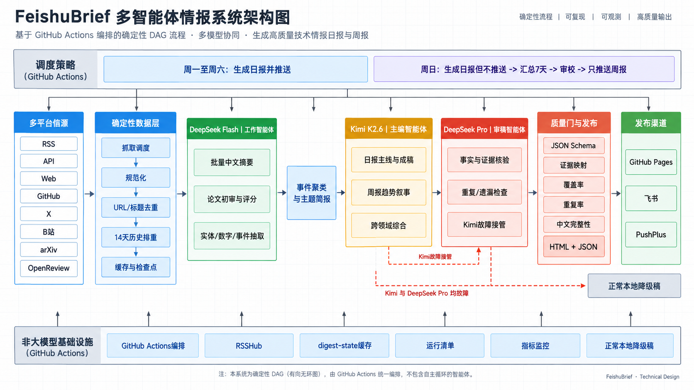
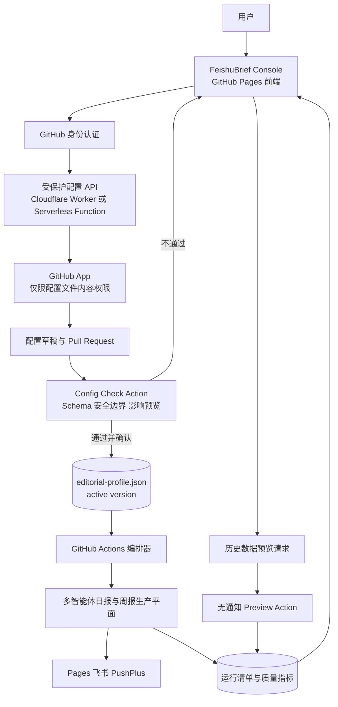

# FeishuBrief 多智能体信源、日报、周报与前端工作台一体化执行方案 V3

## 1. 文档信息

| 项目 | 内容 |
|---|---|
| 文档版本 | V3.0 |
| 文档状态 | 待实施 |
| 适用仓库 | `No1dry/FeishuBrief` |
| 运行环境 | GitHub Actions |
| 输出形态 | 前端策略工作台；周一至周六日报；周日内部日报加对外周报 |
| 模型角色 | DeepSeek Flash 工作智能体、Kimi K2.6 主编、DeepSeek Pro 审稿与接管 |
| 输出渠道 | GitHub Pages、飞书、PushPlus |
| 核心原则 | 人定义策略、模型执行策略、程序掌握发布权；质量优先、可追溯、可回滚 |

本文件在 V2 基础上新增“FeishuBrief Console”前端工作台，保留 V1、V2，不覆盖旧文件。V3 新增或强化：

1. VLA、Agent、World Model、具身智能论文专项策展。
2. 论文质量评分、跨平台去重和 14 天历史排重。
3. 周一至周六日报、周日只推送周报的双周期产品。
4. 周报事件演进聚类、跨日去重和下周观察清单。
5. 三个模型角色的边界、接管关系和调用预算。
6. GitHub Actions 多次错峰探测、幂等运行和通知安全。
7. 日报与周报各自独立的质量门和发布决策。
8. 可视化研究重点、关键词、权重、信源和质量阈值配置。
9. 网页展示与飞书/微信消息摘要完全分离的配置边界。
10. GitHub Pages 前端、受保护配置 API、GitHub App 和配置 PR 审批链。
11. 基于历史 sidecar 的无通知影响预览、配置 Diff、审计和一键回滚。
12. 工作台组件、接口、权限、状态、错误处理和部署方案。

## 2. 当前基础与问题

### 2.1 当前已经具备

- 135 个登记信源，中文模式约 107 个启用信源。
- RSS、API、Web、GitHub、X、B站、YouTube、论文作者等适配器。
- GitHub Actions 内置临时 RSSHub，支持 B站登录态。
- 每日抓取、中文介绍、最终总览、HTML、GitHub Pages、飞书和 PushPlus。
- Kimi 请求超时控制、紧凑恢复请求和正常本地降级稿。
- 正常总览维持 60 条候选：技术 25、财经 20、时政 15。
- 论文已加入 VLA、Agent、World Model、具身智能关键词与确定性质量评分。
- 论文跨 Hugging Face/arXiv ID 去重，读取最近 14 期历史，最多展示 20 篇且允许不足。
- V3 方案文档之前尚无可视化策略工作台，研究重点仍需要修改仓库配置。

### 2.2 当前仍需解决

1. 大量逐项中文摘要与最终成稿集中在 Kimi，吞吐和超时风险仍集中。
2. 同一事件被多家媒体重复报道，尚未稳定形成事件级记录。
3. 当前论文评分以确定性信号为主，缺少模型语义评审和外部学术信号。
4. 每天报告相互独立，尚不能识别“一周内持续发展”的主题。
5. GitHub 单次 cron 可能延迟或不投递，单一触发点无法自我补跑。
6. 日报与通知耦合，缺少正式的“只生成”“只推送已有报告”运行模式。
7. 研究方向、关键词、信源权重和展示策略散落在 JSON 与 TypeScript 中，非开发操作不够方便。
8. 网页端与消息端缺少显式配置隔离，修改展示逻辑时容易误伤通知摘要。
9. 缺少配置生效前的历史数据影响预览、审计记录和可视化回滚入口。

## 3. 建设目标

### 3.1 产品目标

| 周期 | 内部执行 | 用户收到 |
|---|---|---|
| 周一至周六 | 抓取、筛选、分析、生成并发布日报 | 当日日报 |
| 周日 | 照常生成当日日报并保存，但跳过日报通知 | 不收到日报 |
| 周日日报完成后 | 读取周一至周日七份日报和内部产物，生成周报 | 只收到周报 |

### 3.2 质量目标

| 指标 | 日报目标 | 周报目标 |
|---|---:|---:|
| 中文介绍覆盖率 | 100% | 100% |
| 来源可追溯率 | 100% | 100% |
| 明显重复事件占比 | 小于 5% | 小于 3% |
| 无证据数字或实体 | 0 | 0 |
| 论文数量 | 最多 20，必须过阈值 | 5 到 8 篇，必须过二次评审 |
| 历史重复论文 | 最近 14 期内 0 | 同周 0，跨周无变化不重复 |
| 日报候选覆盖 | 60 条 | 读取完整 7 天日报产物 |
| Reviewer 通过分 | 80 分 | 85 分 |
| 模型单点故障导致低质推送 | 0 | 0 |

### 3.3 非目标

- 不构建多个 Agent 自由聊天、无限反思或自主循环的系统。
- 不允许模型自主修改代码、信源、Secret 或推送目标。
- 不把七天全部原始抓取结果直接塞给周报模型。
- 不把出现次数等同于重要性。
- 不为了固定数量加入低质量论文、弱相关事件或旧内容。
- 不在用户可见页面中显示模型失败、重试、超时或降级状态。

### 3.4 工作台目标

- 不改代码即可切换研究重点，例如从 VLA 转向 World Model。
- 不直接编辑 JSON 即可启停信源、调整优先级和每日上限。
- 网页展示数量、日报主编候选和消息摘要数量分别配置。
- 保存前用最近一天或七天 sidecar 预览入选结果和数量变化。
- 每次修改都有版本、作者、时间、差异、校验结果和回滚点。
- 工作台只向单个私有仓库写入白名单配置文件。
- 桌面端提供完整编辑能力，移动端优先查看运行状态和执行回滚。

## 4. 总体架构图



上图描述内容生产平面。V3 在生产平面之上增加前端控制平面：工作台只生成和审批编辑策略，不直接接触模型密钥、飞书群 ID 或运行时进程；日报与周报编排器只读取已经通过校验并标记为 active 的配置版本。

### 4.1 V3 控制平面与生产平面



控制平面和生产平面遵循四条边界：

1. 工作台不能直接调用飞书、PushPlus 或模型接口。
2. 工作台不能读取 Secret、Cookie 或完整通知目标。
3. 未经 Schema 和权限校验的草稿不能成为 active 配置。
4. 生产运行固定读取一个配置版本，运行中途不热更新。

### 4.2 可编辑生产平面架构图

```mermaid
flowchart LR
  S[多平台信源<br/>RSS API Web GitHub X B站<br/>arXiv OpenReview] --> F[抓取调度器]
  F --> N[规范化与安全清洗]
  N --> D[URL 标题 arXiv ID 去重]
  D --> H[14 天历史排重]
  H --> C{摘要缓存命中?}

  C -- 未命中 --> W[DeepSeek Flash<br/>工作智能体]
  C -- 命中 --> E[事件聚类器]
  W --> E
  W --> P[论文语义初审]
  P --> E

  E --> T[主题简报构建器]
  T --> K[Kimi K2.6<br/>主编智能体]
  K --> R[DeepSeek Pro<br/>审稿智能体]
  R --> Q{确定性质量门}
  Q -- 日报通过 --> SUN{周日?}
  SUN -- 周一至周六 --> O[HTML JSON 渲染]
  O --> G[GitHub Pages]
  G --> M[飞书与 PushPlus]

  K -. 超时或失败 .-> R
  K -. 与 Pro 均失败 .-> L[正常本地编辑稿]
  L --> Q

  A[(digest-state<br/>缓存 检查点 运行清单)] <--> C
  A <--> E
  A <--> T

  SUN -- 是 --> WD[保存周日日报<br/>跳过日报通知]
  WD --> WS[读取最近 7 天日报]
  WS --> WE[跨日事件演进聚类]
  WE --> WK[Kimi 周报主编]
  WK --> WR[DeepSeek Pro 周报审校]
  WR --> WQ{周报质量门}
  WQ -- 通过 --> O
```



## 5. 模型数量与角色

系统使用三个模型角色，对应两个模型服务商。一个模型可以运行多个逻辑 Agent，但角色配置、Prompt、输入输出和超时必须隔离。

### 5.1 角色总表

| 模型角色 | 建议模型 | 推理模式 | 主要输入 | 主要输出 | 是否拥有发布权 |
|---|---|---|---|---|---|
| 工作智能体 | `deepseek-v4-flash` | 默认非思考或 low | 规范化条目批次 | TopicItem、PaperAssessment | 否 |
| 主编智能体 | `kimi-k2.6` | 标准 | 结构化主题简报 | DailyReport、WeeklyReport | 否 |
| 审稿智能体 | `deepseek-v4-pro` | low/high | 成稿加证据索引 | ReviewResult、修订意见 | 否 |
| 确定性发布器 | 非大模型 | 不适用 | 成稿、审稿结果、Schema | 发布或阻断决定 | 是 |

DeepSeek 官方当前提供 `deepseek-v4-flash` 与 `deepseek-v4-pro`，支持 JSON Output、OpenAI/Anthropic 兼容接口。正式接入前仍应以官方模型与价格页为准。

### 5.2 DeepSeek Flash 工作智能体

DeepSeek Flash 承担数量大、结构固定、可以并行的任务。

| 逻辑 Agent | 负责内容 | 输出重点 |
|---|---|---|
| Research Worker | 论文、研究机构博客 | 问题、方法、实验、结果、研究价值 |
| Engineering Worker | GitHub、Release、工程博客 | 功能、技术栈、工程价值、适用场景 |
| Industry Worker | 产品、公司、融资、应用 | 产品变化、商业影响、落地证据 |
| People Worker | X、博客、B站、演讲 | 人物观点、事实发布、判断与上下文 |
| Finance Worker | 财经新闻、行情指标 | 宏观、指数、资产、关键数字 |
| Policy Worker | 政府、政策、国际新闻 | 政策、外交、监管、潜在影响 |
| Paper Judge | VLA、Agent、World Model、具身智能论文 | 方向匹配、质量评分、证据、推荐理由 |
| Weekly Extractor | 七天 TopicItem 和日报 | 跨日事件、首次出现、后续进展、趋势强度 |

Flash 不负责最终标题和全局叙事，也不可以决定发送通知。

### 5.3 Kimi K2.6 主编智能体

Kimi 运行两套互相隔离的主编 Prompt。

**日报主编职责：**

- 从 60 条来源均衡的候选中提炼当日主线。
- 生成头条、总览、科技、财经、时政简报。
- 结合 Topic Brief，而不是重新理解全部原始网页。
- 输出正常中文编辑短评和关键词。

**周报主编职责：**

- 从跨日事件链中提炼 3 到 5 条本周核心趋势。
- 区分本周新事件、持续演进事件和没有实质变化的重复报道。
- 重点组织 VLA、Agent、World Model 和具身智能研究进展。
- 形成“本周发生什么、为什么重要、如何发展、下周看什么”的叙事。
- 不按周一到周日机械复述七篇日报。

### 5.4 DeepSeek Pro 审稿与接管智能体

DeepSeek Pro 有两个职责，但在一次运行中必须明确当前身份。

**审稿身份：**

- 检查结论是否能映射到证据条目。
- 检查数字、人名、机构、时间和因果关系。
- 检查同一事件是否重复出现。
- 检查标题是否夸大，摘要是否超出原文。
- 检查周报是否真正体现“变化”，而非出现次数。
- 输出结构化修订意见，最多允许主编修订一次。

**接管身份：**

- Kimi 超时、拒绝或输出无法修复时，使用同一输入独立成稿。
- 接管稿仍需经过确定性质量门。
- 不允许 Reviewer 自己审自己；接管时由确定性门禁加严格阈值负责最终判断。

## 6. 非大模型模块

### 6.1 GitHub Actions 编排器

- 决定日报、周报、只生成和只通知模式。
- 读取时区和日期，保证周日分支正确。
- 负责并发上限、超时、重试、检查点和幂等键。
- 任何模型都不能改变工作流分支。

### 6.2 信源适配层

- RSS/Atom、REST API、HTML 列表、GitHub、X、RSSHub、OpenAlex 等统一为 `NormalizedArticle`。
- 单个信源失败只记录，不阻断其他信源。
- 所有网页内容均视为不可信输入，去除脚本、HTML 和潜在提示注入文本。

### 6.3 规范化与去重层

- URL canonicalization：去跟踪参数、统一跳转、统一尾斜杠。
- arXiv/Hugging Face 按 arXiv ID 跨平台去重。
- DOI、GitHub Repository/Release 使用稳定主键。
- 标题近似度用于多媒体同事件候选聚类。
- 已展示论文读取最近 14 期历史，禁止再次进入日报论文模块。

### 6.4 事件聚类器

- 确切 URL 和规范标题先确定性聚类。
- 标题 Jaccard、实体、时间窗口形成候选簇。
- 只有边界样本交给 DeepSeek Flash 判断。
- 每个事件保存主来源、补充来源、首次时间和最新变化。

### 6.5 缓存与检查点

- 摘要缓存避免同一内容重复调用模型。
- 阶段检查点支持从失败位置恢复，不重新抓取全部来源。
- Prompt 版本、模型角色或正文哈希变化时自动失效。
- 缓存位于私有 `digest-state` 分支，不发布到公开站点。

### 6.6 确定性质量门

- JSON Schema 与字段完整性。
- URL 必须来自输入白名单。
- 数字和实体必须存在于证据索引。
- 日报/周报条数、语言、重复率、覆盖率和审稿分数达标。
- 发布和通知是质量门之后的独立动作。

### 6.7 渲染与通知

- 同一份结构化报告生成 HTML 和 JSON。
- GitHub Pages 成功发布后才允许通知。
- 飞书和 PushPlus 分别记录结果，任何日志不输出 Secret 或完整群 ID。
- 支持指定日期“只推送已有报告”，不重新调用模型。

## 7. 日报执行 DAG

```text
错峰定时探测
-> 幂等检查：今天是否已有成功报告
-> 恢复历史日报与 digest-state
-> 启动 RSSHub
-> 并发抓取全部启用信源
-> 规范化、安全清洗、精确去重
-> 论文方向过滤、质量初筛、14 天历史排重
-> 摘要缓存查询
-> DeepSeek Flash 分领域批量处理未命中项
-> 事件聚类和 Topic Brief
-> 形成 60 条来源均衡候选
-> Kimi 日报主编成稿
-> DeepSeek Pro 独立审稿
-> 最多一次定向修订
-> 确定性质量门
-> 写入日报与运行清单
-> 渲染并发布 GitHub Pages
-> 周一至周六：飞书和 PushPlus 通知
-> 周日：跳过日报通知，进入周报 DAG
```

### 7.1 日报候选配额

| 领域 | 正常候选 | 恢复请求候选 |
|---|---:|---:|
| 技术 | 25 | 16 |
| 财经 | 20 | 11 |
| 时政 | 15 | 9 |
| 合计 | 60 | 36 |

36 条仅用于正常请求已经失败后的紧凑恢复请求。正常路径和本地编辑稿继续使用完整 60 条。

## 8. 周报执行 DAG

### 8.1 数据窗口

- 周报窗口固定为本地时区周一 00:00 至周日当日日报完成。
- 输入为七份 `<date>.json`、七份已展示条目索引和事件聚类产物。
- 不重新请求 RSS、网页、X、B站或论文平台。
- 不把七天 6000 条左右的原始抓取内容直接送入模型。

### 8.2 周报流水线

```text
验证七天日报完整性
-> 读取 DailyReport、TopicItem、EventCluster、论文选择记录
-> 规范化跨日事件 ID
-> 合并同一事件的连续进展
-> 标记：首次出现 / 有实质进展 / 无变化重复
-> DeepSeek Flash 分领域生成 WeeklyTopicBrief
-> 选择本周 3-5 条主线和 5-8 篇重点论文
-> Kimi 周报主编成稿
-> DeepSeek Pro 按证据逐项审校
-> 最多一次修订
-> 周报质量门
-> 发布 `/weekly/<ISO-WEEK>/`
-> 只推送周报到飞书和 PushPlus
```

### 8.3 周报内容结构

1. 本周一句话判断。
2. 本周总览：技术、市场和政策主线。
3. 3 到 5 条核心趋势，每条包含变化链和影响。
4. VLA、Agent、World Model、具身智能专题观察。
5. 本周 5 到 8 篇重点论文及“为什么值得看”。
6. 工程、开源、模型和产品的重要发布。
7. 影响技术产业的财经与政策信号。
8. 下周观察清单。

### 8.4 周报不是七篇日报拼接

以下输出视为失败：

- 按日期罗列“周一发生、周二发生”。
- 同一事件用不同媒体标题重复多次。
- 只统计出现次数，不说明实质变化。
- 只有摘要，没有判断依据和影响。
- 把没有更新的上周主题再次包装成新趋势。

## 9. 论文专项智能体

### 9.1 研究重点

一级重点：

- VLA / Vision-Language-Action。
- Agent / Agentic System，优先 LLM Agent、工具调用、软件工程 Agent、自主研究。
- World Model，包括视频世界模型、潜在动力学和可交互环境模型。
- 具身智能、Robot Learning、Robot Policy、Visuomotor Learning。

### 9.2 候选来源

- arXiv `cs.AI`、`cs.LG`，先按标题和摘要关键词过滤。
- Hugging Face Daily Papers，保留点赞和趋势信号。
- OpenReview，仅接收正式论文、接收状态、oral/spotlight/poster，不抓首页公告。
- 重点作者 OpenAlex 论文。
- 后续可补充 Semantic Scholar、Papers with Code、GitHub 代码链接。

### 9.3 两阶段评分

**阶段 A：确定性评分。**

| 信号 | 用途 |
|---|---|
| 方向关键词与同义词 | 硬相关性 |
| 摘要长度和方法描述 | 信息完整度 |
| benchmark、实验、消融、真实环境 | 证据强度 |
| code、dataset、open-source | 可复现性 |
| Hugging Face upvotes | 社区关注度 |
| 时间、作者、机构 | 新鲜度与来源背景 |
| 偏离领域词和公告页 | 惩罚项 |

低于确定性阈值的候选不调用模型。

**阶段 B：DeepSeek Paper Judge。**

```ts
interface PaperAssessment {
  paperKey: string;
  focusTags: Array<"VLA" | "Agent" | "World Model" | "Embodied AI">;
  relevance: number;
  novelty: number;
  evidenceStrength: number;
  reproducibility: number;
  potentialImpact: number;
  confidence: number;
  recommendation: "must-read" | "recommended" | "skip";
  reasonZh: string;
  evidence: string[];
}
```

### 9.4 论文展示规则

- 每日最多 20 篇，不设“必须凑满”的下限。
- arXiv 合计最多 6 到 8 篇，防止单平台占满。
- 同一 arXiv ID 只保留质量信息更完整的一条。
- 最近 14 期已经展示过的论文不再出现。
- 每周从当周日报已入选论文中二次选择 5 到 8 篇。
- 没有符合条件的 VLA 论文时，VLA 分组允许为空，不用泛机器人论文冒充。

## 10. 数据协议

### 10.1 NormalizedArticle

```ts
interface NormalizedArticle {
  id: string;
  canonicalUrl: string;
  sourceId: string;
  sourceName: string;
  category: "tech" | "finance" | "politics";
  subcategory?: string;
  title: string;
  excerpt: string;
  publishedAt?: string;
  fetchedAt: string;
  sourceTier: "T0" | "T1" | "T2" | "T3";
  contentHash: string;
}
```

### 10.2 TopicItem

```ts
interface TopicItem {
  articleId: string;
  canonicalUrl: string;
  sourceId: string;
  topic: string;
  event: string;
  summaryZh: string;
  entities: string[];
  numbers: string[];
  technologies: string[];
  importance: number;
  novelty: number;
  confidence: number;
  evidence: Array<{ claim: string; sourceUrl: string }>;
}
```

### 10.3 EventCluster

```ts
interface EventCluster {
  clusterId: string;
  category: "tech" | "finance" | "politics";
  topic: string;
  primaryArticleId: string;
  articleIds: string[];
  sourceCount: number;
  firstSeenAt: string;
  lastChangedAt: string;
  changeType: "new" | "updated" | "unchanged";
  mergedSummaryZh: string;
  importance: number;
  confidence: number;
}
```

### 10.4 WeeklyEvent

```ts
interface WeeklyEvent {
  weeklyEventId: string;
  clusterIds: string[];
  title: string;
  firstSeenDate: string;
  lastChangedDate: string;
  evolution: Array<{
    date: string;
    change: string;
    evidenceUrls: string[];
  }>;
  trendStrength: number;
  weeklyImportance: number;
  whyItMattersZh: string;
}
```

### 10.5 WeeklyReport

```ts
interface WeeklyReport {
  isoWeek: string;
  weekStart: string;
  weekEnd: string;
  heroHeadline: string;
  weeklyOverview: string;
  coreTrends: WeeklyEvent[];
  researchFocus: Array<{
    topic: string;
    summaryZh: string;
    evidenceUrls: string[];
  }>;
  keyPapers: Array<{
    title: string;
    url: string;
    whyItMattersZh: string;
  }>;
  engineeringAndIndustry: TopicItem[];
  financeAndPolicy: TopicItem[];
  nextWeekWatchlist: string[];
  keywords: string[];
}
```

### 10.6 ReviewResult 与发布决定

```ts
interface ReviewResult {
  pass: boolean;
  score: number;
  unsupportedClaims: string[];
  duplicateEvents: string[];
  missingCoverage: string[];
  languageIssues: string[];
  revisionInstructions: string[];
}

interface PublicationDecision {
  publishPage: boolean;
  sendNotifications: boolean;
  reasonCodes: string[];
}
```

## 11. 调用与接管策略

### 11.1 Worker 批次

| 参数 | 建议值 |
|---|---:|
| 每批条目 | 12 到 16 |
| 并发批次 | 3 |
| 单批超时 | 120 秒 |
| SDK 自动重试 | 0 |
| 编排层重试 | 1 |
| 输出 | JSON Schema |
| 思考模式 | 默认关闭，论文边界判断用 low |

### 11.2 日报主编

| 参数 | 正常请求 | 恢复请求 |
|---|---:|---:|
| 候选条目 | 60 | 36 |
| 超时 | 300 秒 | 240 秒 |
| 最大输出 | 8192 tokens | 6144 tokens |
| SDK 自动重试 | 0 | 0 |
| 编排层次数 | 1 | 1 |

### 11.3 周报主编

| 参数 | 建议值 |
|---|---:|
| 输入 | 7 天 Topic Brief、事件链、论文精选 |
| 最大核心事件 | 30 |
| 超时 | 360 秒 |
| 最大输出 | 10000 tokens |
| 恢复输入 | 20 个最高分事件 |
| 最大修订轮数 | 1 |

### 11.4 故障矩阵

| 故障 | 日报处理 | 周报处理 |
|---|---|---|
| Flash 单批失败 | 重试一次，之后缓存或本地摘要 | 跳过失败批并检查覆盖 |
| Kimi 超时 | DeepSeek Pro 接管 | DeepSeek Pro 接管 |
| Reviewer 超时 | 确定性门后可继续日报 | 不自动发送周报，保留待审核页面 |
| 两个模型均失败 | 正常本地日报 | 生成内部草稿，不发送周报通知 |
| Pages 发布失败 | 不通知 | 不通知 |
| 七天日报不完整 | 不影响当日日报 | 阻断周报通知并在 Actions 告警 |

周报优先保证质量，不以“每周必须发”为最高目标。低质量周报宁可不通知，也不能把错误或机械拼接内容发出去。

## 12. 质量门禁

### 12.1 日报硬门

- JSON 可解析且必填字段完整。
- Brief URL 全部来自候选白名单。
- 技术展示条目中文介绍覆盖率 100%。
- 正常总览使用 60 条候选；只有恢复请求可使用 36 条。
- 论文均通过方向和质量阈值，最多 20 篇，允许不足。
- 论文最近 14 期历史重复数为 0。
- 用户可见内容不含模型、超时、重试、兜底等运维词。
- 网页发布成功前不得发送通知。

### 12.2 周报硬门

- 周一至周日七份日报和运行清单齐全。
- 每个核心趋势至少包含一个可访问证据 URL。
- 声称“持续发展”的事件至少有两个日期节点。
- 同一事件只能出现一次。
- 本周重点论文必须来自当周已入选论文，且无重复。
- `nextWeekWatchlist` 必须来自未完结事件或明确时间节点。
- Reviewer 总分不低于 85。
- 任一硬门失败时可以发布内部页面，但不得推送飞书或 PushPlus。

### 12.3 周报评分

| 维度 | 权重 |
|---|---:|
| 一周主线判断与重要性 | 25 |
| 跨日演进而非重复罗列 | 20 |
| 证据和事实准确性 | 20 |
| VLA/Agent/World Model 研究覆盖 | 15 |
| 信息密度与中文表达 | 10 |
| 下周观察价值 | 10 |

## 13. 缓存、记忆与幂等

### 13.1 缓存键

```text
summary:v2:<contentHash>:<locale>:<promptVersion>:<modelRole>
paper:v2:<paperKey>:<promptVersion>
cluster:v2:<sortedArticleHashes>
weekly:v2:<isoWeek>:<dailyManifestHashes>
```

### 13.2 状态目录

```text
state/
  summary-cache-v2.jsonl
  paper-assessments-v2.jsonl
  event-cache-v2.jsonl
  run-manifests/
    daily/2026-09-13.json
    weekly/2026-W37.json
  checkpoints/
```

### 13.3 幂等键

```text
daily:<Asia-Shanghai-date>
weekly:<ISO-week>
notify:<report-type>:<report-id>:<channel>
```

相同幂等键成功后，后续错峰定时只检查状态，不重复生成和推送。

## 14. GitHub Actions 设计

### 14.1 定时可靠性

不要只保留一个整点 cron。建议每天配置三个错峰探测，例如北京时间 08:07、10:17、12:27，对应 UTC 时间写入 workflow。每次运行先检查当日报告幂等键：

- 已成功：立即结束。
- 未生成：开始正式日报。
- 正在运行：结束，不创建第二次任务。
- 上次失败且没有成功产物：从检查点恢复。

### 14.2 Workflow 分支

```yaml
mode:
  scheduled: auto
  generate_only: false
  notify_only: false
  report_date: optional
```

运行模式：

| 模式 | 抓取 | 模型 | 发布网页 | 通知 |
|---|---|---|---|---|
| `auto` 周一至周六 | 是 | 是 | 是 | 日报 |
| `auto` 周日 | 是 | 是 | 日报加周报 | 仅周报 |
| `generate_only` | 是 | 是 | 是 | 否 |
| `notify_only` | 否 | 否 | 否 | 指定已有报告 |

### 14.3 Secrets

| Secret | 用途 |
|---|---|
| `ANTHROPIC_API_KEY` | Kimi 主编接口凭证 |
| `DEEPSEEK_API_KEY` | DeepSeek Flash/Pro |
| `X_BEARER_TOKEN` | X 信源 |
| `GIT_SOURCE_TOKEN` | GitHub 信源 |
| `BILIBILI_COOKIE_0` | B站 RSSHub 登录态 |
| `ACTIONS_DEPLOY_KEY` | 发布公开站点 |

Secret 不进入 Prompt、报告、中间公开 JSON 或日志。

### 14.4 Variables

```text
MULTI_AGENT_ENABLED=true

LLM_WORKER_BACKEND=deepseek
LLM_WORKER_MODEL=deepseek-v4-flash
LLM_WORKER_BASE_URL=https://api.deepseek.com

LLM_EDITOR_BACKEND=anthropic
LLM_EDITOR_MODEL=kimi-k2.6
LLM_EDITOR_BASE_URL=https://api.moonshot.cn/anthropic

LLM_REVIEWER_BACKEND=deepseek
LLM_REVIEWER_MODEL=deepseek-v4-pro
LLM_REVIEWER_BASE_URL=https://api.deepseek.com

LLM_WORKER_CONCURRENCY=3
LLM_CACHE_BRANCH=digest-state
LLM_REVIEW_ENABLED=true
WEEKLY_REPORT_ENABLED=true
WEEKLY_REPORT_DAY=0
PAPER_HISTORY_DAYS=14
```

旧的 `LLM_BACKEND`、`LLM_MODEL` 保留为兼容和回滚路径。

## 15. 中间产物与公开产物

### 15.1 私有中间产物

```text
daily_reports/<date>/internal/
  raw-articles.json
  normalized-articles.json
  paper-assessments.json
  topic-items.json
  event-clusters.json
  topic-briefs.json
  review-result.json
  run-manifest.json
```

### 15.2 公开日报

```text
daily_reports/<date>/
  <date>.json
  <date>.html
  <date>-articles.json
```

### 15.3 公开周报

```text
daily_reports/weekly/<iso-week>/
  <iso-week>.json
  <iso-week>.html
```

公开 sidecar 只保留页面需要的数据，不发布模型原始响应、错误栈、Secret、Cookie、内部置信度明细或完整缓存。

## 16. 代码改造清单

### 16.1 新增模块

```text
lib/ai/roles.ts
lib/ai/orchestrator.ts
lib/ai/contracts.ts
lib/ai/quality-gates.ts

lib/ai/agents/research-worker.ts
lib/ai/agents/engineering-worker.ts
lib/ai/agents/industry-worker.ts
lib/ai/agents/people-worker.ts
lib/ai/agents/finance-worker.ts
lib/ai/agents/policy-worker.ts
lib/ai/agents/paper-judge.ts
lib/ai/agents/daily-editor.ts
lib/ai/agents/weekly-editor.ts
lib/ai/agents/reviewer.ts

lib/pipeline/normalize.ts
lib/pipeline/dedupe.ts
lib/pipeline/cluster.ts
lib/pipeline/cache.ts
lib/pipeline/checkpoint.ts
lib/pipeline/run-manifest.ts

lib/weekly/collect.ts
lib/weekly/evolution.ts
lib/weekly/pipeline.ts
lib/weekly/render.ts
```

### 16.2 修改模块

| 文件 | 改造内容 |
|---|---|
| `lib/ai/llm.ts` | 按角色创建客户端和配置 |
| `lib/ai/backends/*.ts` | 角色级超时、重试、JSON 和 reasoning 参数 |
| `lib/ai/enrich.ts` | 迁移到并发 Worker Agents |
| `lib/ai/pipeline.ts` | 日报 DAG 编排、审校和接管 |
| `lib/papers/curation.ts` | 接入 DeepSeek Paper Judge 与外部学术信号 |
| `scripts/daily.ts` | 检查点、运行清单、周日分支 |
| `scripts/notify-*.mjs` | 指定日报/周报 ID 和通知幂等 |
| `lib/output/render.ts` | 显示事件来源、研究方向和周报入口 |
| `.github/workflows/daily.yml` | 错峰探测、四种模式、角色变量、周报分支 |

## 17. 实施阶段

### Phase 0：已完成基础修复

- [x] 正常总览 60 条与紧凑恢复 36 条分离。
- [x] 最终请求超时和 SDK 重试控制。
- [x] 正常本地日报成稿。
- [x] 技术动态中文介绍覆盖。
- [x] VLA、Agent、World Model、具身智能论文关键词。
- [x] 论文确定性评分、跨平台去重和 14 天排重。
- [x] 论文最多 20、允许不足。

### Phase 1：角色路由

- [ ] 定义 `worker/editor/reviewer` 三种模型角色。
- [ ] 每个角色独立 backend、model、base URL、timeout 和 retry。
- [ ] 支持 DeepSeek JSON Output。
- [ ] 保持旧配置回滚路径。

验收：三个角色可以单独调用，错误和统计互不混淆。

### Phase 2：规范化、缓存与事件记忆

- [ ] URL、DOI、arXiv、GitHub 稳定主键。
- [ ] 标题近似去重和事件候选簇。
- [ ] `digest-state` 缓存与检查点。
- [ ] DailyRunManifest 和幂等键。

验收：同一 sidecar 重跑时 Worker 缓存命中率达到 95%。

### Phase 3：DeepSeek Workers 与论文智能体

- [ ] 六类 Worker Prompt。
- [ ] Paper Judge 语义评分。
- [ ] 外部学术信号适配器。
- [ ] 每批 12 到 16 条、并发 3、单批独立恢复。

验收：中文介绍 100%，论文人工抽查相关率和质量合格率不低于 90%。

### Phase 4：日报主编与审稿

- [ ] Kimi 读取 Topic Brief 成稿。
- [ ] DeepSeek Pro 独立审稿。
- [ ] 最多一次定向修订。
- [ ] Kimi 失败时 Pro 接管。
- [ ] 确定性质量门决定发布。

验收：任一模型临时不可用时，不发布低质量或含运维文案的日报。

### Phase 5：周报系统

- [ ] 收集本周七天日报和事件簇。
- [ ] 构建跨日事件演进链。
- [ ] Weekly Extractor、Weekly Editor、Weekly Reviewer。
- [ ] 周报 HTML、JSON、归档和网页入口。
- [ ] 周日跳过日报通知，只发送周报。

验收：周报无机械日期罗列，核心趋势均有证据和跨日变化。

### Phase 6：Actions 与运行可靠性

- [ ] 三个错峰 cron 和幂等检查。
- [ ] `generate_only` 与 `notify_only`。
- [ ] Pages 成功后再通知。
- [ ] Job Summary、告警和运行清单。

验收：重复 cron 不重复生成或通知；缺失 cron 能由后续探测恢复。

## 18. 测试方案

### 18.1 单元测试

- URL、arXiv ID、DOI 规范化。
- 精确和近似去重。
- 论文方向匹配、阈值、平台配额和历史排重。
- 角色配置优先级。
- Schema、证据 URL 和数字校验。
- 日报/周报通知幂等。

### 18.2 固定数据回放

- 使用最近七天已发布 sidecar，不访问外部信源。
- 对比单模型与多智能体日报。
- 检查周报事件链是否正确合并。
- 人工抽查 VLA、Agent、World Model 论文入选和淘汰理由。
- 不发送飞书和 PushPlus。

### 18.3 故障注入

| 场景 | 预期 |
|---|---|
| DeepSeek 429 | 降并发、编排层重试一次、使用缓存 |
| Worker 返回空 JSON | Schema 拒绝，仅重跑该批 |
| Kimi 超时 | DeepSeek Pro 接管 |
| Reviewer 超时 | 日报走确定性门；周报不通知 |
| 两个模型失败 | 日报本地成稿；周报只保存内部草稿 |
| 某个信源超时 | 记录失败，其他来源继续 |
| 七天少一天 | 周报通知阻断 |
| Pages 失败 | 所有通知阻断 |
| 三个 cron 都触发 | 只有首个获得幂等锁的运行执行 |

## 19. 可观测性

GitHub Job Summary 至少输出：

```text
Schedule: mode / local date / weekday / idempotency key
Sources: enabled / success / zero / failed
Articles: fetched / normalized / deduplicated / clustered
Papers: candidate / focus matched / threshold passed / history excluded / displayed
Cache: hit / miss / hit rate
Agents: role / calls / success / retry / fallback / latency
Daily: candidate coverage / reviewer score / publication decision
Weekly: days loaded / event chains / repeated clusters / reviewer score
Publish: pages / feishu / pushplus / notification idempotency
```

告警阈值：

- 信源成功率低于 85%。
- 论文方向匹配突然为 0。
- Worker 缓存命中率异常下降。
- 任一模型 P95 超过 180 秒。
- 日报 Reviewer 低于 80。
- 周报 Reviewer 低于 85。
- 周日七天数据不完整。
- 使用本地日报成稿或阻断周报通知。

## 20. 成本控制

- Flash 只处理缓存未命中项，不处理每日全部 800 到 900 条。
- 先做确定性论文过滤，再调用 Paper Judge。
- 周报复用七天 TopicItem，不重新摘要原始网页。
- Reviewer 只读取成稿和证据索引，不读取全部原文。
- 每个角色单独记录输入、输出 token 和缓存命中。
- DeepSeek 存在峰谷价格时，可在不影响时效的情况下将非关键回放测试放在低价时段。

预算必须以真实 token 日志和官方价格为准，不在代码中写死费用预测。

## 21. 安全与通知边界

- 抓取内容统一视为不可信数据，禁止其改变系统 Prompt 或调用工具。
- Worker 不具备网络、Shell、文件写入和通知工具。
- 主编和 Reviewer 不接收 Secret、Cookie、完整群 ID。
- 模型返回 URL 必须在候选白名单中。
- 通知目标只来自 GitHub Variables，不允许模型或抓取内容覆盖。
- `notify_only` 必须显式指定报告类型和报告 ID。
- 日报与周报分别维护通知幂等键，避免重复发送。
- 测试模式默认不包含通知步骤。

## 22. 回滚方案

```text
MULTI_AGENT_ENABLED=false
WEEKLY_REPORT_ENABLED=false
```

回滚后：

1. 日报恢复当前 Kimi 单模型路径。
2. 已实现的论文关键词、确定性评分和历史排重继续保留。
3. 周日恢复普通日报推送，避免没有任何通知。
4. 缓存、中间产物和周报草稿保留，不删除。
5. 修复后使用固定数据回放，不需要重新抓取历史信源。

## 23. 最终验收标准

- [ ] 三个模型角色按配置独立运行。
- [ ] DeepSeek Flash 承担批量工作，Kimi 不再处理全部逐项摘要。
- [ ] Kimi 负责日报和周报叙事，DeepSeek Pro 独立审稿。
- [ ] 正常日报仍使用 60 条候选。
- [ ] 论文聚焦 VLA、Agent、World Model、具身智能。
- [ ] 论文最多 20，低质量时允许少于 20。
- [ ] 最近 14 期论文无重复。
- [ ] 同一事件多来源合并且可追溯。
- [ ] 周一至周六只推送日报。
- [ ] 周日生成日报但不通知，随后只推送周报。
- [ ] 周报完整读取七天日报，不重新抓取。
- [ ] 周报核心趋势呈现事件演进而非日期拼接。
- [ ] 周报重点论文 5 到 8 篇且经过二次评审。
- [ ] Pages 失败时飞书和 PushPlus 均不发送。
- [ ] 重复 cron 和手动重跑不重复通知。
- [ ] 用户可见内容不出现模型和运行故障信息。

## 24. 推荐实施顺序

1. 角色级模型路由和统一 JSON 协议。
2. `digest-state` 缓存、检查点和运行清单。
3. DeepSeek Flash 六类 Worker。
4. Paper Judge 和外部学术质量信号。
5. 事件聚类和 Topic Brief。
6. Kimi 日报主编与 DeepSeek Pro 审稿。
7. 周报事件演进和 WeeklyReport。
8. 周日分支、错峰 cron、幂等与通知安全。
9. 七天固定数据回放和故障注入。
10. 一次只生成不通知的完整验收。
11. 正式启用并保留开关回滚。

## 25. FeishuBrief Console 产品定位

FeishuBrief Console 是编辑策略与运行状态工作台，不是第二个日报网页，也不是模型聊天界面。它面向仓库所有者和后续可能加入的编辑人员，主要解决以下工作：

- 定义“现在重点关注什么”。
- 定义“什么质量才允许进入日报或周报”。
- 定义“网页展示多少、消息摘要展示多少”。
- 查看信源、模型、缓存、质量门和通知的运行状态。
- 在不推送消息的情况下预览配置影响。
- 审批、发布和回滚配置版本。

### 25.1 设计方向

采用安静、紧凑、工具化的运营控制台：

- 不制作营销首页或大幅 Hero。
- 第一屏直接进入工作台总览。
- 左侧窄导航、顶部运行状态、主区域高密度表格与表单。
- 颜色只用于状态和风险：绿色通过、黄色待确认、红色阻断、蓝色信息。
- 卡片只用于单个指标、重复条目或弹窗，不把整个页面切成多层卡片。
- 图标按钮使用统一图标库，并提供 tooltip。
- 所有数值控件使用 slider、stepper 或数字输入；二元状态使用 switch。
- 权重和阈值修改时实时显示预计影响，不使用模糊的“智能优化”文案。

### 25.2 使用角色

| 角色 | 权限 | 典型操作 |
|---|---|---|
| Owner | 查看、编辑、提交、激活、回滚 | 调整研究重点、信源和模型策略 |
| Editor | 查看、编辑草稿、运行预览 | 添加关键词、调整模块权重 |
| Viewer | 只读 | 查看运行记录、质量分和当前配置 |
| GitHub Actions | 读取 active 配置 | 生成日报和周报 |
| GitHub App | 白名单文件读写 | 创建配置分支和 PR |

初期只有仓库 Owner 一个用户，也应保留角色模型，避免未来扩展时重做权限边界。

## 26. 信息架构与页面

### 26.1 全局导航

```text
总览
研究重点
信源管理
论文策略
日报与周报
消息摘要
模型与质量
运行中心
配置版本
系统设置
```

### 26.2 页面职责

| 页面 | 解决的问题 | 核心输出 |
|---|---|---|
| 总览 | 系统今天是否健康、当前关注什么 | 状态、当前 Profile、最近运行、质量趋势 |
| 研究重点 | 调整 VLA、Agent、World Model 等主题 | ResearchProfile |
| 信源管理 | 哪些来源启用、优先级如何 | SourceOverrides |
| 论文策略 | 什么论文值得进入、多久不重复 | PaperPolicy |
| 日报与周报 | 两种报告结构和生成周期 | ReportPolicy、WeeklyPolicy |
| 消息摘要 | 飞书/微信各显示多少条 | NotificationPolicy |
| 模型与质量 | 模型角色、超时、预算、门槛 | ModelPolicy、QualityPolicy |
| 运行中心 | 哪一步失败、耗时和结果如何 | RunManifest、QualityReport |
| 配置版本 | 谁改了什么、如何回滚 | ConfigVersion、Diff |
| 系统设置 | 时区、预览、GitHub App 状态 | SystemPolicy |

### 26.3 工作台页面骨架

```text
┌──────────────┬──────────────────────────────────────────────────────────┐
│              │ 当前 Profile · active 版本 · 最近运行 · 下次计划        │
│ Navigation   ├───────────────────────────────────────┬──────────────────┤
│ Rail         │                                       │ Impact Preview   │
│              │ 页面标题、筛选器、主要操作            │                  │
│ 总览         │                                       │ 历史命中变化     │
│ 研究重点     │ 表格 / 表单 / 运行时间线              │ 入选与移除样本   │
│ 信源管理     │                                       │ 成本与调用变化   │
│ 论文策略     │                                       │ 网页/消息变化    │
│ 日报与周报   │                                       │                  │
│ 消息摘要     ├───────────────────────────────────────┴──────────────────┤
│ 模型与质量   │ 草稿状态 · 字段变更数 · 保存草稿 · 查看 Diff · 提交变更 │
│ 运行中心     │                                                          │
│ 配置版本     │                                                          │
└──────────────┴──────────────────────────────────────────────────────────┘
```

桌面端右侧持续展示影响预览，移动端将其折叠为底部抽屉。页面主操作区只保留当前任务所需命令，激活、回滚和发送通知等高风险操作不常驻全局导航。

## 27. 全局前端组件

### 27.1 AppShell

**功能：** 提供导航、路由、权限上下文、当前配置版本和全局错误边界。

**展示：**

- 左侧导航栏。
- 顶部状态栏。
- 主内容区域。
- 右侧可收起的影响预览面板。
- 底部保存状态和版本信息。

**边界：** AppShell 不直接保存表单；所有编辑先进入 DraftStore。

### 27.2 NavigationRail

**功能：** 页面切换、未保存标记和权限控制。

**行为：**

- 有未保存更改时，导航项显示小圆点。
- 离开页面不丢失 DraftStore。
- Viewer 隐藏所有写入命令。
- 移动端折叠为图标菜单。

### 27.3 SystemStatusBar

**功能：** 展示与当前决策最相关的系统状态。

**字段：**

- 当前 active 配置版本。
- 最近日报/周报状态。
- 当前模型角色状态。
- 下次计划运行时间。
- 是否有待审批配置。
- 是否处于只生成或通知阻断状态。

状态栏不展示完整 Secret、群 ID 或 Cookie。

### 27.4 DraftStore

**功能：** 保存尚未提交的工作台修改，计算字段级 Diff。

**规则：**

- 浏览器刷新后可以恢复本地草稿，但敏感字段永不进入 localStorage。
- 每次修改记录来源页面和时间。
- 支持撤销/重做。
- 切换配置 Profile 前提示保存或丢弃当前草稿。

### 27.5 ImpactPreviewPanel

**功能：** 实时解释当前修改可能带来的结果。

**展示：**

- 预计命中的历史文章数量。
- 新增和被移除的论文。
- 各来源预计入选比例。
- 网页展示数量变化。
- 飞书/微信摘要数量变化。
- 预算和预计模型调用量变化。

影响预览优先使用最近 sidecar 做确定性计算；只有点击“深度预览”才触发无通知 Action 和模型调用。

## 28. 研究重点组件

### 28.1 ResearchProfileSelector

**功能：** 选择、复制、重命名和归档编辑策略 Profile。

预设示例：

```text
VLA Focus
Agent Systems
World Model Focus
Embodied AI
Balanced AI Frontier
```

归档 Profile 不会删除历史版本。active Profile 只能有一个。

### 28.2 TopicPriorityTable

**功能：** 管理研究主题、优先级和占比。

| 字段 | 控件 | 说明 |
|---|---|---|
| 启用 | Switch | 是否参与筛选 |
| 主题名称 | Text input | 例如 World Model |
| 优先级 | Segmented control | P0、P1、P2 |
| 权重 | Slider + number | `0.0` 到 `2.0` |
| 每日目标上限 | Stepper | 仅上限，不强制补齐 |
| 颜色 | Swatch | 仅用于工作台标签 |

权重为 0 等同于暂时停用，但保留关键词和历史。

### 28.3 KeywordEditor

**功能：** 编辑关键词、同义词、缩写和排除词。

一个主题包括：

```ts
interface ResearchTopic {
  id: string;
  name: string;
  enabled: boolean;
  priority: "P0" | "P1" | "P2";
  weight: number;
  keywords: string[];
  aliases: string[];
  excludeKeywords: string[];
  languages: Array<"zh" | "en">;
  dailyMax?: number;
}
```

**校验：**

- 自动去重和修剪空格。
- 不允许任意正则表达式，避免 ReDoS 和错误匹配。
- 标记过短、歧义大或命中量异常的词，例如单独的 `model`。
- 展示每个词在最近七天 sidecar 中的命中样本。
- 排除词只降低或阻断入选，不删除原始抓取记录。

### 28.4 TopicCoveragePreview

**功能：** 用条形图和样本列表展示主题覆盖。

**指标：**

- 最近一天和七天命中数。
- 去重后事件数。
- 质量阈值通过数。
- 各信源占比。
- 与其他主题重叠率。

例如将 World Model 权重从 `0.4` 调到 `1.0` 后，面板应立即显示预计增加和移除的候选，而不是只提示“保存成功”。

## 29. 信源管理组件

### 29.1 SourceRegistryTable

**功能：** 扫描和管理全部信源。

**列：**

- 启用状态。
- 信源名称和平台。
- 领域/子模块。
- P0/P1/P2。
- 语言。
- 抓取方式。
- 每日上限。
- 最近成功时间。
- 最近抓取数量。
- 七天成功率。
- 最近错误摘要。

支持按领域、地区、平台、优先级、状态和错误类型筛选。表格默认紧凑模式，不使用大卡片展示每个信源。

### 29.2 SourceDetailDrawer

**功能：** 查看和修改单个信源。

**可编辑：**

- enabled、tier、topics、dailyLimit。
- 关键词、包含路径、排除路径。
- 抓取超时和重试策略的安全范围。
- 所属报告模块。

**只读：**

- authRef 名称。
- 最近运行统计。
- 最近五次错误。
- 最近抓取样本。

工作台永远不返回 authRef 对应的 Secret 值。

### 29.3 SourceHealthBadge

**状态：** `healthy`、`zero-items`、`degraded`、`failed`、`auth-required`。

Badge 只表达状态，不用颜色替代文字；鼠标悬停显示最近一次检查时间和简短原因。

### 29.4 BulkSourceActions

**功能：** 批量启停、调整优先级和每日上限。

批量操作必须先显示受影响信源清单；超过 10 个信源时要求在配置 Diff 中再次确认。

## 30. 论文策略组件

### 30.1 PaperFocusPanel

**功能：** 将研究主题映射到论文筛选。

- 选择哪些 ResearchTopic 参与论文筛选。
- 配置方向匹配最低分。
- 配置 Agent 是否限定为 LLM Agent、工具调用、软件工程或自主研究。
- 配置 VLA 与具身智能的相邻词范围。

### 30.2 PaperQualityControls

| 配置 | 控件 | 默认建议 |
|---|---|---:|
| 最低综合分 | Slider | 52 |
| 每日最多论文 | Stepper | 20 |
| arXiv 最大占比 | Slider | 30% 到 40% |
| 历史排重天数 | Stepper | 14 |
| 周报重点论文 | Range stepper | 5 到 8 |
| 必须有摘要 | Switch | 开启 |
| 代码/数据加分 | Slider | 7 |
| 实验/基准加分 | Slider | 8 |

所有上限都是限制，不是补齐目标。

### 30.3 PaperCandidateInspector

**功能：** 展示“入选、临界、淘汰”论文及原因。

每篇显示：

- 标题、来源、arXiv ID、发布日期。
- 研究方向标签。
- 确定性分、DeepSeek 语义分、最终分。
- 代码/数据/实验信号。
- 历史是否已展示。
- 入选或淘汰理由。

该组件使评分可解释，避免只看到一个不透明的总分。

## 31. 报告与消息组件

### 31.1 DailyReportPolicyEditor

**功能：** 配置日报候选与摘要结构。

```text
主编候选：技术 25 / 财经 20 / 时政 15
恢复候选：技术 16 / 财经 11 / 时政 9
网页技术模块：按各模块独立上限
论文：最多 20，质量不足允许更少
```

正常主编候选和恢复候选必须分别编辑，界面明确提示恢复配置只在正常请求失败时使用。

### 31.2 WeeklyReportPolicyEditor

**功能：** 配置周报窗口、主题数量和质量要求。

- 周报星期和时区。
- 是否生成周日内部日报。
- 七天完整性要求。
- 核心趋势 3 到 5 条。
- 重点论文 5 到 8 篇。
- Reviewer 最低分 85。
- 数据不完整或审稿失败时禁止通知。

### 31.3 WebLayoutPolicyPanel

**功能：** 只控制完整网页。

可配置：

- 各一级和二级模块是否显示。
- 各模块最多条数。
- 模块顺序。
- 是否显示来源、时间、研究标签和原文摘要。

该配置不得影响 `DailyReport.tech_briefs`、`finance_briefs`、`politics_briefs` 和消息端数量。

### 31.4 NotificationSummaryPanel

**功能：** 独立配置飞书与 PushPlus 摘要卡片。

建议锁定默认值：

| 渠道 | 科技 | 财经 | 时政 | 总览 | 市场观察 |
|---|---:|---:|---:|---|---|
| 飞书 | 5 | 5 | 3 | 显示 | 显示 |
| PushPlus | 5 | 5 | 3 | 显示 | 可选 |

**硬边界：**

- 消息数量不能继承网页模块上限。
- 少于科技 3、财经 3、时政 2 时拒绝发送。
- 工作台不能编辑通知目标群，只能编辑消息结构。
- 任何变更都必须在手机宽度预览中检查文本截断。

### 31.5 NotificationPreview

**功能：** 使用真实历史报告模拟飞书和微信样式，但不调用发送接口。

提供桌面和手机两种宽度；展示最终截断字符数、按钮、关键词和各栏目条数。

## 32. 模型、质量与运行组件

### 32.1 ModelRoleMatrix

**功能：** 配置工作、主编、审稿三个模型角色。

| 字段 | 是否可编辑 | 说明 |
|---|---|---|
| Backend | 是 | deepseek、anthropic 等白名单 |
| Model | 是 | 从服务端白名单选择 |
| Base URL | 受限 | 只能选择管理员登记的 endpoint |
| Timeout | 是 | 限定安全范围 |
| Max tokens | 是 | 限定角色上限 |
| Concurrency | Worker 可编辑 | 不超过系统上限 |
| API Key | 否 | 只显示“已配置/未配置” |

### 32.2 QualityGateEditor

**功能：** 配置日报和周报软评分门槛及硬规则开关。

不可关闭的硬规则：

- URL 白名单。
- JSON Schema。
- 通知最小栏目数。
- Secret 不进入输出。
- Pages 失败不通知。

可以调整的规则：论文阈值、Reviewer 分数、来源多样性目标和重复率警戒线。

### 32.3 RunCenter

**功能：** 按时间查看每次日报、周报、预览和只通知任务。

每行显示：

- 日期、类型、触发方式和 GitHub Run ID。
- 当前阶段与总耗时。
- 信源成功/失败/零条数量。
- 论文候选/历史排除/入选数量。
- 各模型调用次数、耗时和接管情况。
- Reviewer 分数和最终发布决定。
- Pages、飞书、PushPlus 各自状态。

### 32.4 RunDetailTimeline

**功能：** 展开一次运行的阶段时间线和可公开错误摘要。

错误日志必须经过脱敏；不展示请求 Header、Secret、Cookie、完整群 ID 和模型原始敏感输出。

### 32.5 ManualRunDialog

**命令：**

- 只抓信源。
- 用历史数据预览。
- 只生成并发布，不通知。
- 只推送指定已有日报或周报。

所有会发送消息的命令必须明确展示报告日期、报告类型和目标渠道；测试群或正式群由后端策略决定，不能自由输入任意群 ID。

## 33. 配置版本与发布组件

### 33.1 ConfigDiffViewer

**功能：** 按语义展示配置变化，而不只是原始 JSON Diff。

示例：

```text
研究重点
  World Model 权重：0.4 -> 1.0
  VLA 权重：1.0 -> 0.3

消息摘要
  飞书科技条数：5 -> 5（未变化）

预计影响
  最近七天论文候选：+12 / -8
  预计每日 Worker 调用：+1 批
```

### 33.2 ConfigValidationPanel

**功能：** 展示 Schema、权限、范围、历史预览和通知边界检查结果。

检查全部通过前，“提交生效”按钮保持禁用。

### 33.3 SaveDraftButton

**功能：** 将草稿保存到受保护后端，不修改 active 配置。

草稿有独立 ID、创建者和过期时间。草稿不触发日报。

### 33.4 SubmitChangeButton

**功能：** 创建配置分支和 PR。

提交内容包括：

- 结构化配置变更。
- 人类可读的语义 Diff。
- 预览结果摘要。
- Config Schema 版本。

### 33.5 ActivateVersionButton

**功能：** 在 PR 合并并通过检查后，将该提交标记为 active。

active 版本写入配置文件本身或受保护的版本指针，不依赖浏览器本地状态。

### 33.6 RollbackDialog

**功能：** 选择历史版本、查看反向 Diff、创建回滚 PR。

回滚也是一次新提交，不重写 Git 历史。移动端只允许执行已验证版本的回滚，不开放复杂编辑。

## 34. 前端配置协议

建议新增：

```text
config/
  editorial-profile.schema.json
  editorial-profile.json
  source-overrides.json
```

### 34.1 editorial-profile.json

```json
{
  "schemaVersion": 3,
  "activeProfile": "world-model-focus",
  "researchTopics": [
    {
      "id": "vla",
      "name": "VLA",
      "enabled": true,
      "priority": "P1",
      "weight": 0.4,
      "keywords": ["VLA", "vision-language-action"],
      "aliases": ["vision language action", "robotic foundation model"],
      "excludeKeywords": []
    },
    {
      "id": "world-model",
      "name": "World Model",
      "enabled": true,
      "priority": "P0",
      "weight": 1.0,
      "keywords": ["world model", "video world model"],
      "aliases": ["latent dynamics", "interactive world model"],
      "excludeKeywords": []
    }
  ],
  "papers": {
    "minimumScore": 52,
    "dailyMaximum": 20,
    "historyDays": 14,
    "arxivMaximum": 6,
    "weeklyMinimum": 5,
    "weeklyMaximum": 8
  },
  "daily": {
    "editorCandidates": { "tech": 25, "finance": 20, "politics": 15 },
    "recoveryCandidates": { "tech": 16, "finance": 11, "politics": 9 }
  },
  "notifications": {
    "feishu": { "tech": 5, "finance": 5, "politics": 3 },
    "pushplus": { "tech": 5, "finance": 5, "politics": 3 }
  },
  "weekly": {
    "enabled": true,
    "weekday": 0,
    "requireCompleteDays": 7,
    "reviewMinimumScore": 85
  }
}
```

### 34.2 配置优先级

```text
代码安全硬限制
> active editorial profile
> source override
> 代码默认值
```

环境变量只用于 Secret、endpoint 和基础设施开关。编辑策略尽量进入版本化配置，避免配置散落在 GitHub Variables 中。

## 35. 前端与后端接口

### 35.1 推荐部署

```text
前端：React + TypeScript + Vite，GitHub Actions 构建，GitHub Pages 托管
认证：GitHub App 用户身份或 GitHub OAuth
配置 API：Cloudflare Worker 或等价 Serverless Function
写入：GitHub App installation token
配置存储：私有 FeishuBrief 仓库
运行状态：GitHub Actions API + 脱敏 run-manifest
```

前端不能内置 PAT。GitHub App 应只安装到 `No1dry/FeishuBrief`，并尽量只授予配置文件内容权限。

### 35.2 API 草案

| 方法 | 路径 | 功能 |
|---|---|---|
| GET | `/api/config/active` | 读取 active 配置和版本 |
| POST | `/api/config/validate` | Schema 与语义校验 |
| POST | `/api/config/preview` | 创建历史数据预览任务 |
| POST | `/api/config/drafts` | 保存草稿 |
| POST | `/api/config/changes` | 创建配置 PR |
| GET | `/api/config/versions` | 查询历史版本 |
| POST | `/api/config/rollback` | 创建回滚 PR |
| GET | `/api/runs` | 查询运行清单 |
| GET | `/api/runs/:id` | 查询单次脱敏详情 |
| POST | `/api/runs/generate-only` | 触发只生成模式 |
| POST | `/api/runs/notify-only` | 推送已有报告 |

所有写接口要求 CSRF 防护、身份校验、仓库权限校验和操作审计。

### 35.3 预览任务

快速预览在浏览器或配置 API 内运行确定性筛选，不调用模型。深度预览通过 `workflow_dispatch` 触发 GitHub Action：

```text
读取指定历史 sidecar
-> 应用草稿配置
-> 运行筛选、聚类和模型流程
-> 生成私有预览产物
-> 不发布正式页面
-> 不发送飞书和 PushPlus
-> 将质量指标返回工作台
```

### 35.4 配置发布链路

```text
编辑字段
-> DraftStore 生成语义 Diff
-> Config API 校验身份、Schema 和字段白名单
-> GitHub App 创建配置分支与 PR
-> Config Check Action 执行静态校验和历史回放
-> Owner 审阅并合并
-> active 配置指向新提交
-> 下一次日报/周报在启动时固定读取该版本
```

一次运行开始后要把配置提交 SHA 写入 RunManifest；即使工作台随后激活了新版本，正在执行的任务也继续使用启动时固定的配置，避免同一份日报前后规则不一致。

## 36. 前端状态与错误处理

### 36.1 必备状态

- Loading：使用骨架行，不改变表格宽度。
- Empty：说明是没有数据还是被筛选为空。
- Validation error：定位到具体字段并提供修复说明。
- Conflict：active 版本已变化，要求重新基于最新版本生成 Diff。
- Unauthorized：停止展示私有运行数据并重新认证。
- Preview running：显示 GitHub Run ID、阶段和取消入口。
- Preview failed：展示脱敏错误和可重试阶段。
- Saved draft：明确说明尚未生效。
- Active：显示生效提交和时间。

### 36.2 乐观更新边界

主题权重和本地表单可以乐观更新；创建 PR、激活版本、回滚和触发运行必须等待服务端确认，不能只在界面上假装成功。

### 36.3 并发冲突

保存变更时提交 `baseCommitSha`。后端发现 active SHA 已变化则返回 `409 Conflict`，前端展示字段级冲突，不强制覆盖他人修改。

## 37. 工作台安全设计

- GitHub Pages 只包含静态资源和公开运行状态；私有数据必须经认证 API。
- API 只允许 GitHub 账号白名单或仓库授权用户。
- GitHub App 使用短期 installation token，不把私钥传到浏览器。
- GitHub App 只写 `config/` 白名单路径，拒绝 `.github/workflows/`、`scripts/` 和 Secret。
- 关键词、标题和信源内容按不可信输入处理并转义。
- Base URL 只能从服务端白名单选择，避免 SSRF。
- 工作台不能读取、创建或回显模型 Key、Cookie、Deploy Key 和通知群 ID。
- 所有配置写入、预览、激活、回滚和通知操作进入审计日志。
- `notify-only` 后端必须验证报告已发布、质量门通过且目标是仓库预设渠道。

## 38. 工作台代码结构

建议在同一仓库新增独立应用目录：

```text
apps/console/
  src/
    app/
    pages/
      overview/
      research-focus/
      sources/
      papers/
      reports/
      notifications/
      models-quality/
      runs/
      versions/
    components/
    api/
    state/
    schemas/
  public/
  package.json

services/config-api/
  src/
    auth.ts
    github-app.ts
    config.ts
    preview.ts
    runs.ts
    audit.ts

config/
  editorial-profile.schema.json
  editorial-profile.json
  source-overrides.json
```

前端使用现有仓库独立构建命令，不改变日报 Node 运行时依赖。配置 Schema 在前端、API 和 Actions 三处复用同一份源文件。

## 39. V3 实施阶段

### Phase 7：配置协议抽离

- [ ] 将研究主题、论文阈值、报告数量和通知数量移入 Schema。
- [ ] 保留当前代码默认值作为兼容回退。
- [ ] 增加配置迁移和版本检查。
- [ ] 网页与消息配置彻底分离。

验收：手动修改配置文件即可从 VLA Focus 切换到 World Model Focus，不改 TypeScript。

### Phase 8：只读工作台

- [ ] AppShell、总览、信源表、运行中心和当前配置页面。
- [ ] 读取脱敏运行清单。
- [ ] GitHub Pages 自动构建和发布。
- [ ] 桌面、平板和手机布局检查。

验收：工作台可以准确显示当前配置和最近运行，但没有任何写权限。

### Phase 9：配置编辑与预览

- [ ] ResearchProfile、KeywordEditor、论文策略和报告策略。
- [ ] DraftStore、Schema 校验、语义 Diff。
- [ ] 最近一天/七天快速预览。
- [ ] 深度预览 Action，严格无通知。

验收：调整 World Model 权重后能看到历史候选变化，正式配置仍未改变。

### Phase 10：GitHub App 与版本发布

- [ ] 创建最小权限 GitHub App。
- [ ] 配置 API、身份验证、CSRF 和审计。
- [ ] 创建配置 PR、检查、激活和回滚。
- [ ] 处理 base SHA 冲突。

验收：工作台不能修改配置白名单外的仓库文件，任何变更均有 PR 和审计记录。

### Phase 11：运行控制

- [ ] 只抓取、只生成、历史预览和只通知命令。
- [ ] 报告日期、类型和渠道确认。
- [ ] 运行状态实时轮询或事件更新。
- [ ] 通知幂等和预设目标限制。

验收：预览不产生任何消息；只通知不会重新抓取或调用模型。

## 40. V3 工作台验收标准

- [ ] 研究方向、权重、关键词和排除词可视化编辑。
- [ ] 从 VLA 转向 World Model 不需要修改代码。
- [ ] 全部 135 个信源可检索、筛选并查看健康状态。
- [ ] 论文阈值、上限、平台占比和历史排重可配置。
- [ ] 网页展示数量与飞书/微信摘要数量为独立字段。
- [ ] 飞书和 PushPlus 默认保持 5/5/3 摘要结构。
- [ ] 工作台无法读取或修改 Secret 和通知群 ID。
- [ ] 保存前可以查看语义 Diff 和历史影响预览。
- [ ] 深度预览不发布、不通知。
- [ ] 配置修改通过 GitHub App 创建 PR。
- [ ] Config Check 失败时不能激活。
- [ ] 每次修改和回滚都有审计记录。
- [ ] 运行中心能定位信源、模型、质量门和通知阶段问题。
- [ ] 桌面端功能完整，移动端文本和控件不重叠。
- [ ] active 配置切换不影响正在执行的日报。

## 41. 推荐交付顺序

先完成 V2 的模型路由、数据协议和事件聚类，再进行工作台写入能力。工作台可以提前交付只读版，但不能让 UI 先于配置 Schema 成为真实配置来源。

```text
配置 Schema
-> 多智能体生产平面读取配置
-> 只读工作台
-> 历史影响预览
-> GitHub App 写入
-> PR 审批与回滚
-> 手动运行控制
```

这一顺序能避免出现“界面已经能调，但后端只有部分参数真正生效”的假工作台。

## 42. 参考资料

- [DeepSeek 模型与价格](https://api-docs.deepseek.com/quick_start/pricing/)
- [DeepSeek API 更新记录](https://api-docs.deepseek.com/updates/)
- [DeepSeek Responses API](https://api-docs.deepseek.com/api/create-response/)
- [Moonshot AI 开放平台](https://platform.moonshot.cn/)
- [GitHub App 用户访问令牌](https://docs.github.com/en/apps/creating-github-apps/authenticating-with-a-github-app/generating-a-user-access-token-for-a-github-app)
- [GitHub App REST API](https://docs.github.com/en/rest/apps/apps)
- [GitHub Actions workflow 语法](https://docs.github.com/en/actions/reference/workflows-and-actions/workflow-syntax)

本方案的本质不是让模型自由协商，而是用 GitHub Actions 驱动一张可恢复、可审计、可回滚的确定性 DAG。DeepSeek 负责规模化理解和独立审校，Kimi 负责中文主编判断，非大模型模块掌握历史、证据、质量门和发布权。
